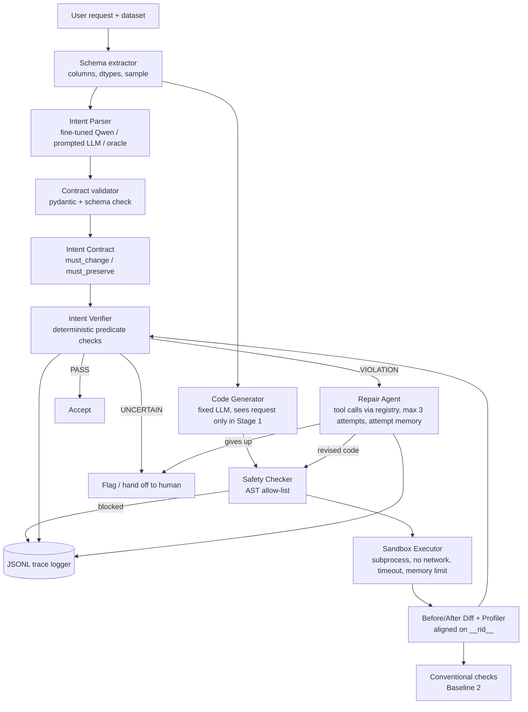

# Intent-Gated Data Transformation Agent: Implementation Roadmap

**Team SSSS** · LMA Group Project 2026
**Status:** Draft for team review. No code has been written yet.

This document is the development plan for the project. It is based on two sources:

- `handout.txt`: the official project handout. Cited as **§N** (handout section).
- `proposal.txt`: our submitted proposal. Cited as **p.N** (proposal page).

Anything marked **[Rec]** is a recommendation from the planning stage. It is not in either document and is open for discussion.

> **Process rule (§6):** do not start implementation until the TA has approved the proposal.

---

## Contents

0. [Decisions needed before we start](#0-decisions-needed-before-we-start)
1. [Project understanding and objectives](#1-project-understanding-and-objectives)
2. [Handout requirements checklist](#2-handout-requirements-checklist)
3. [Proposal compared with the handout](#3-proposal-compared-with-the-handout)
4. [System architecture](#4-system-architecture)
5. [Technology stack](#5-technology-stack)
6. [Phase-wise roadmap](#6-phase-wise-roadmap)
7. [Repository structure](#7-repository-structure)
8. [MVP and priorities](#8-mvp-and-priorities)
9. [Testing, evaluation, and validation](#9-testing-evaluation-and-validation)
10. [Risks and mitigations](#10-risks-and-mitigations)
11. [Final implementation checklist](#11-final-implementation-checklist)
12. [Review notes](#12-review-notes)

---

## 0. Decisions needed before we start

| # | Decision | Options | Team answer |
|---|---|---|---|
| D1 | TA approval status | (a) approved as written, (b) approved with feedback (paste it), (c) not yet submitted or reviewed | |
| D2 | Available GPU | (a) Colab/Kaggle T4 16 GB, (b) lab GPU ≥ 24 GB on Linux, (c) laptop GPU or CPU only | |
| D3 | Deadline and milestones | (a) about 4–6 weeks (drop P2 items), (b) about 8+ weeks (P2 feasible), (c) other dates | |
| D4 | Team size | The proposal lists 4 members; this plan assumes 3. Confirm. | |
| D5 | Predicate vocabulary additions | Add `columns_added` and `rows_retained_where`? (see G10) | |
| D6 | Proposal updates | Send fixes for G1, G4, G8, G13 to the TA? | |

Already decided:

- **LLM access:** local open models (Qwen family).
- **Language:** Python, starting from scratch.

Also note: the proposal still contains a leftover line, "Doubts to discuss:" (p.3). Remove it in the next revision.

---

## 1. Project understanding and objectives

**The idea.** LLM-written pandas code often runs without errors but does the wrong thing. It might drop valid rows, change unrelated columns, or deduplicate on the wrong key. We turn each request into an **intent contract** built from a small fixed set of checkable statements (predicates). The contract has two halves:

- `must_change`: what the transformation is expected to change.
- `must_preserve`: what it must leave untouched.

After the code runs, a deterministic verifier compares the data before and after against the contract. If it finds a violation, a bounded repair loop gets a few attempts to fix the code.

**Research question (p.1–2).** Does an intent contract that specifies what must change and what must be preserved improve the detection of silent semantic errors in LLM-generated data transformations, compared with conventional data-quality checks?

**Hypothesis (p.2).** Intent-based verification will accept fewer incorrect transformations while keeping the false-rejection rate low.

**What we have to show:**

1. Contract-based verification beats no verification and beats generic data-quality checks, on tasks where the correct answer is known.
2. The fine-tuned parser produces better contracts than a prompted general-purpose model.
3. The repair loop improves final accuracy.
4. Nothing unsafe ever runs.

---

## 2. Handout requirements checklist

| # | Requirement | Source | Type |
|---|---|---|---|
| H1 | A real problem, a new approach, a prototype, and an evaluation, rather than "just a chatbot or RAG app" | §1 | Mandatory |
| H2 | A clear research question, method, evaluation setup, and evidence for or against the hypothesis | §1, §7 | Mandatory |
| H3 | Combine several of the five capabilities, not just one | §2 | Mandatory |
| H4 | For each capability: why the problem needs it, and how it is measured | §2 | Mandatory |
| H5 | Tool calling: right tool chosen, valid arguments, recovery from errors, no unsafe actions | §2.5 | Mandatory (we use it) |
| H6 | Agentic: the system decides its next step over several steps (planning, memory, state, hand-off to a human) | §2.4 | Mandatory (we use it) |
| H7 | Fine-tuning is lightweight only (LoRA/QLoRA on a small model) | §2.1, §5 | Constraint |
| H8 | Narrow scope | §4 | Constraint |
| H9 | Small or open models; small, carefully designed evaluation sets | §5 | Constraint |
| H10 | Compute budget: GPU type and hours, API calls or tokens, **number of experiment runs** | §5 | Strongly expected (TAs may reject without it) |
| H11 | TA approval before implementation | §6 | Mandatory |
| H12 | A working prototype that uses a sandbox or mock tools for actions | §7.5 | Mandatory |
| H13 | At least one baseline | §7 | Mandatory |
| H14 | A small evaluation set with known ground truth | §7 | Mandatory |
| H15 | At least one quantitative metric per capability used | §7 | Mandatory |
| H16 | An ablation of each capability the research question depends on | §7 | Mandatory |
| H17 | Tool-call accuracy and the rate of unsafe or unapproved actions | §7 | Mandatory |
| H18 | Qualitative examples of hard or interesting cases | §7 | Mandatory |
| H19 | Failure analysis | §7 | Mandatory |
| H20 | Don't rely only on a demo or one LLM-judge score; validate any LLM judge against human labels | §7 | Mandatory |
| H21 | Write-up covering problem, related work, method, experiments, results, limitations, future work | §7.8 | Mandatory deliverable |
| H22 | The proposal contents listed in §8 | §8 | Mandatory (proposal) |
| O1 | Using all five capabilities, RAG, or reasoning | §2 | Optional |
| O2 | Extra ablations beyond the required ones | §7 ("encouraged") | Optional / bonus |
| O3 | Good enough for a workshop submission | §6 | Aspirational |

---

## 3. Proposal compared with the handout

### 3.1 Already covered

- **H1, H2, H3:** three capabilities (p.2–3) and a clear research question.
- **H7, H9:** QLoRA on Qwen2.5-1.5B/3B (p.10).
- **H8:** five transformation types, three datasets (p.5–6).
- **H13:** three baselines (p.6–7), more than required.
- **H14:** gold contracts plus reference transformations (p.6).
- **H15:** metrics for each capability (p.9).
- **H17:** safety metrics with a target of zero unsafe actions (p.9–10).
- **H20:** no LLM judge (p.5, p.9).
- Oracle-contract ablation (p.8) and risk register (p.10).
- **H22:** every section listed in §8 is present.

### 3.2 Gaps and weak spots

| ID | Gap | Why it matters | [Rec] Fix |
|---|---|---|---|
| G1 | **No source of incorrect transformations is defined** | Detection recall needs known errors. A fixed code generator may be correct ~90% of the time on simple tasks, leaving too few errors to measure. | Build a **candidate pool** per task: the reference solution, **planted faulty variants** (§7 allows "injected scenarios"), and some LLM samples. Label each candidate correct or incorrect by comparing its output with the reference output. |
| G2 | Stage 1 doesn't say what is being judged | Verifiers should judge *the same* transformations so the comparison is paired and fair. | In Stage 1, every system judges the same frozen candidate pool. |
| G3 | The code generator receives the contract in the diagram (p.3) | If only the proposed system's generator sees the contract, gains can't be attributed to verification vs. generation. | Stage 1: the generator sees only the request, in every system. Contract-conditioned generation becomes a separate Stage 2 variant. |
| G4 | **No ablation of the "bidirectional" claim** | The novelty (p.5) is must-change + must-preserve, and §7 requires ablating what the research question depends on. | Add two ablations: must-change only, and must-preserve only. |
| G5 | Tool calling is a fixed pipeline | §2.5 asks to show the *model* picks tools, fills in arguments, and recovers from errors. Hardcoded calls don't show that. | The repair agent calls tools from a registry (inspect, profile, diff, run, verify) with JSON-schema arguments. Measure tool selection and argument validity. |
| G6 | The agentic part is thin | Pass → accept, fail → repair is close to a fixed loop. | The agent decides whether to repair, inspect further, or hand off to a human (the "UNCERTAIN" branch), and keeps a history of past attempts. |
| G7 | "UNCERTAIN / Flag" is undefined | It affects the metrics. | UNCERTAIN = contract failed to parse, references an unknown column, or a predicate can't be evaluated. Report it separately, and count it as a reject in the main metrics. |
| G8 | Silent semantic error rate and recall overlap | If both use "incorrect transformations" as the denominator, the error rate is just 1 − recall. | Define silent error rate = incorrect-and-accepted ÷ all accepted (how polluted accepted outputs are). Report recall and false-rejection rate as well. |
| G9 | No method for matching rows before and after | `column_values_unchanged` can't be checked after filtering or dedup without knowing which row is which. | Add a hidden `__rid__` row-ID column before execution. Instruct the generator to keep it. If it's missing afterwards, return UNCERTAIN. |
| G10 | The predicate vocabulary misses some cases | Column transformations that *add* columns, and "rows not matching the filter must be kept". | Proposed additions: `columns_added`, `rows_retained_where`. Freeze the vocabulary before annotation. |
| G11 | Fine-tuning data could leak into evaluation | 3–5k auto-generated examples over the *same* datasets could copy evaluation patterns. | Generate training data from **different schemas/datasets** and templates. Hold out evaluation datasets, or at least their columns and phrasings. |
| G12 | Who generates the code isn't stated | Qwen 1.5B writes poor pandas code. | Use one fixed generator (e.g. Qwen2.5-Coder-7B-Instruct, 4-bit) for every system. |
| G13 | Number of experiment runs is missing (H10) | TAs may reject the proposal without it. | Add the estimate from §5.3 below. |
| G14 | Qualitative examples are not mentioned (H18) | Required by §7. | Hand-picked case studies in Phase 11. |
| G15 | "0 unsafe actions" is untested | Zero means nothing if nothing unsafe was attempted. | Add a red-team set: unsafe requests and code using `os`, `open`, sockets, `eval`, etc. |
| G16 | No statistical treatment | Small evaluation sets (§5) need confidence intervals. | Wilson or bootstrap confidence intervals; McNemar's test for paired system comparisons. |
| G17 | Reasoning isn't claimed, but diagnosis reasons | Fine — §2 allows "varying amounts". | Don't claim it. Diagnosis-trace analysis is optional (P2). |

### 3.3 Conflicts with the handout

- No direct conflicts. The project fits §5 (small models, local inference) and §4 (narrow scope).
- The only process risk is H11: starting code before TA approval.

---

## 4. System architecture



### 4.1 Components

| Component | Responsibility | Uses LLM? |
|---|---|---|
| Schema extractor | Reads column names, dtypes, null counts, and a few sample rows. Feeds both the parser and the generator. | No |
| Intent parser | Request + schema → contract JSON. Three swappable implementations: fine-tuned, prompted, oracle. | Yes |
| Contract validator | Checks JSON against the schema and that target columns exist. Fails as UNCERTAIN. | No |
| Code generator | Request + schema → `transform(df) -> df` function. | Yes (fixed model) |
| Safety checker | AST scan. Only `pandas` and `numpy` imports allowed. Blocks `open`, `exec`, `eval`, `__import__`, `os`, `sys`, `subprocess`, `socket`, `pathlib`, and dunder attribute access. | No |
| Sandbox executor | Runs code in a separate process with CPU, memory, and time limits, in a temp directory, with no network. Data passed via parquet/pickle file. | No |
| Diff and profiler | Rows removed/added, changed cells per column, dtype changes, null changes — aligned on `__rid__`. | No |
| Intent verifier | One deterministic function per predicate. Returns per-predicate status and overall PASS / VIOLATION / UNCERTAIN. | No |
| Conventional checker | Baseline 2's fixed generic suite: schema, nulls, dtypes, uniqueness, ranges, row consistency, distribution shift. | No |
| Repair agent | Receives the violation report and attempt history. Calls tools, proposes fixed code, or hands off to a human. | Yes |
| Tool registry | Tool name, JSON argument schema, handler. Validates every call; returns structured errors the agent can recover from. | No |
| Orchestrator | State machine `PARSE → GENERATE → CHECK → EXECUTE → VERIFY → REPAIR* → DONE`. Enforces the attempt limit and termination. | No |
| Tracer | One JSONL record per step: inputs, outputs, tokens, latency, verdict. All metrics are computed from traces. | No |

### 4.2 Request flow (proposed system, Stage 2)

1. A request and a CSV come in. The schema is extracted and `__rid__` is added to every row.
2. The parser produces a contract; the validator checks it. Invalid → UNCERTAIN.
3. The generator produces code; the safety checker scans it. Blocked code is logged as an unsafe attempt.
4. The sandbox runs the code and saves the output.
5. The diff is computed and the verifier checks each predicate.
6. PASS → accept. VIOLATION → repair agent (at most 3 attempts). UNCERTAIN or giving up → hand off to a human.
7. The trace is written, and the evaluator compares the final output with the reference output.

### 4.3 Termination and error handling

- Repair agent: at most 3 attempts. Every tool call has a timeout. Each run has a total token budget.
- Malformed LLM JSON: one re-prompt including the error message, then counted as a failure.
- Sandbox crashes or timeouts are returned to the agent as structured observations.

---

## 5. Technology stack

### 5.1 Libraries

| Area | Choice | Build or reuse | Why / trade-offs |
|---|---|---|---|
| Language | Python 3.11 | — | Matches pandas, PEFT, and DS-1000. |
| Data | pandas, numpy, pyarrow | Reuse | This is what is being transformed. |
| Contract schema | pydantic v2 | Reuse library, build schema | Strict validation; exports JSON schema usable for constrained decoding. |
| Verifier, diff, conventional checks | Plain pandas | **Build** | This is the research core. Great Expectations/Pandera would hide the logic. Our own ~7 generic checks also document exactly what Baseline 2 contains. |
| Agent loop, tool registry, orchestrator | Plain Python | **Build** | The course rewards understanding the mechanisms. LangChain/LangGraph would hide exactly what we're graded on. |
| Sandbox | `subprocess` + `resource` limits + timeout + AST checker; network cut via `unshare -n`, or Docker `--network none` if available | Build | Docker is stronger but needs setup. Start with subprocess, add Docker if possible. |
| Fine-tuning | `transformers` + `peft` + `trl` (SFTTrainer) + `bitsandbytes` (QLoRA) | Reuse | Standard; fits a 16 GB GPU. |
| Inference | `vLLM` on a Linux GPU (serves LoRA adapters, JSON-guided decoding), otherwise plain `transformers` | Reuse, behind an `LLMClient` interface | A few hundred calls is fine with `transformers`. Ollama would require converting adapters to GGUF. |
| Structured output | JSON-schema constrained decoding (vLLM guided decoding or `outlines`) + pydantic re-validation | Reuse | Small models break JSON. **Same decoding for every parser** to keep the comparison fair. |
| Config and runs | YAML configs per experiment, fixed seeds | Build | Reproducibility. |
| Tests | `pytest`, `ruff` | Reuse | Unit tests for every predicate and tool. |
| Statistics and plots | `scipy` / `statsmodels` (McNemar, Wilson), `matplotlib` | Reuse | For G16. |

Dependency versions will be pinned in `requirements.txt` in Phase 0.

### 5.2 Models [Rec]

| Role | Model | Notes |
|---|---|---|
| Parser to fine-tune | Qwen2.5-1.5B-Instruct and Qwen2.5-3B-Instruct | Training both gives a "size vs. tuning" result — the handout's own example (§2.1). Qwen3-1.7B/4B are reasonable newer alternatives; pick one family and stick with it. |
| Baseline 3 general parser | Qwen2.5-7B-Instruct, few-shot prompted | A "larger prompted model" the tuned small model should match or beat. |
| Code generator (fixed for all systems) | Qwen2.5-Coder-7B-Instruct, 4-bit | 1.5B/3B are too weak at pandas; we want a realistic error rate. |
| Repair agent | Qwen2.5-7B-Instruct | Supports tool calling; 1.5B calls tools unreliably. |

### 5.3 Compute estimate (to add to the proposal — H10, G13)

- **Fine-tuning:** ~2–4 GPU h per model size × 2 sizes × ~2 hyperparameter runs ≈ **8–16 GPU hours** on a T4 / L4 / A10-class GPU.
- **Stage 1:** ~70 tasks × ~7 candidates ≈ 500 judgments per system. Only the parser calls an LLM: ~70 calls per parser per seed.
- **Stage 2:** ~70 tasks × 4 systems × up to 4 generations × 3 seeds ≈ 3.4k generation calls plus agent calls — a few GPU hours of 7B inference.
- **API cost:** $0 (all local).

---

## 6. Phase-wise roadmap

**Ordering principle:** the research core (verifier + candidate pool + oracle contracts) is built first, with **no LLM involved**. That tests the research question early. If the oracle-contract verifier doesn't beat conventional checks, we find out in week 2, not week 8.

### Phase 0 — Setup and approval gate

- **Objective:** repository, environment, and data ready; TA approval recorded.
- **Covers:** H11, H10.
- **Tasks:**
  1. Confirm TA approval. Update the proposal with fixes for G1, G4, G8, G13 if the TA allows.
  2. Create the repository skeleton (§7), `requirements.txt`, `pyproject.toml`.
  3. Set up `pytest` and `ruff`.
  4. Download scripts for Airbnb, Adult, and Wine Quality into `data/raw/`, with checksums.
  5. Confirm GPU access.
- **Depends on:** nothing.
- **Delivers:** repository, working environment, raw data, approval record.
- **Done when:** `pytest` runs (even if empty), all three datasets load in pandas, approval is written down.

### Phase 1 — Contract schema and deterministic verifier (research core)

- **Objective:** contract + before/after data → per-predicate verdicts.
- **Covers:** H2, H14 (machinery), G7, G9, G10.
- **Components:**
  - `contracts/schema.py` — pydantic models `Predicate`, `Condition`, `IntentContract`.
  - `contracts/normalize.py` — canonical form for matching (predicate type + target + normalized condition/value).
  - `verifier/alignment.py` — `__rid__` injection and alignment.
  - `verifier/predicates/*.py` — one function per predicate: `check(before, after, pred) -> PredicateResult`.
  - `verifier/verifier.py` — combines results into PASS / VIOLATION / UNCERTAIN with a report.
- **Tasks:**
  1. Freeze predicate vocabulary v1: the 8 from p.4, plus `columns_added` and `rows_retained_where` if agreed (D5). Write `docs/predicates.md` with exact semantics, including tolerances (float `atol`, null comparison, dtype families).
  2. Implement schema and normalization.
  3. Implement alignment.
  4. Implement each predicate.
  5. Implement the verifier.
- **Tests:** per predicate, a small handmade DataFrame with a passing case, a violating case, and edge cases (empty frame, all nulls, missing column → UNCERTAIN, dropped `__rid__` → UNCERTAIN). Normalization treats equivalent conditions as equal (e.g. `price < 0` written two ways).
- **Depends on:** Phase 0.
- **Done when:** all predicate tests pass; the verifier report lists each failed predicate with example rows; the vocabulary document is frozen.

### Phase 2 — Evaluation task set and candidate pool (parallel with Phase 1)

- **Objective:** ground-truth data with labels known in advance.
- **Covers:** H14, G1, G2, G11, Risk 3 (p.10).
- **Components:**
  - `eval/tasks/*.yaml` — id, dataset, type, request text, reference code, gold contract.
  - `eval/mutations.py` — operators that plant faulty variants.
  - `eval/equivalence.py` — `outputs_equal(ref, cand)`, ignoring row order and index, with dtype tolerance.
  - `eval/build_pool.py` — builds `pool.jsonl` of (task, candidate code, is_correct).
- **Tasks:**
  1. Write ~70 tasks across 5 types × 3 datasets (~4–5 per combination).
  2. Reference code and gold contract for each.
  3. Mutation operators, e.g.: off-by-one filter boundary; filter on the wrong column; dedup on all columns instead of a key (or the reverse); `fillna` on every column; `dropna` instead of `fillna`; `errors='coerce'` turning valid values into NaN; overwriting a source column in place; dropping an unrelated column; sort that breaks row identity; `reset_index` that drops `__rid__`.
  4. 3–5 faulty variants per task, plus 0–2 harmless variants (correct but written differently) to test false rejections.
  5. A second teammate re-annotates ~20% of gold contracts. Measure predicate-level agreement, fix ambiguous definitions, drop tasks that stay ambiguous.
- **Tests:** every reference passes its gold contract (checks Phase 1 and annotations together). Every faulty variant differs from the reference under `outputs_equal`.
- **Depends on:** Phase 0 (final check needs Phase 1).
- **Done when:** ~70 tasks, ~400–500 labelled candidates, agreement figure written down, all references passing, annotation guide in `docs/`.

### Phase 3 — Sandbox, safety checker, and tools

- **Objective:** run untrusted code safely; expose operations as tools.
- **Covers:** H5, H12, H17, G15.
- **Components:**
  - `sandbox/ast_guard.py`.
  - `sandbox/executor.py` — `run(code, df) -> ExecResult(ok, df_out, stderr, timed_out, blocked)`.
  - `tools/registry.py` — `Tool(name, args_schema, handler)`; `call(name, args) -> ToolResult` validates arguments and returns structured errors.
  - `tools/data_tools.py` — `inspect_dataset`, `profile_column`, `diff_datasets`, `run_transformation`, `verify_contract`.
- **Tasks:**
  1. AST allow-list.
  2. Subprocess executor with limits.
  3. Tool registry and the 5 tools.
  4. Red-team set in `eval/redteam/`: ~15–20 samples that read/write files, use the network, run shell commands, use `eval`, exhaust memory, or loop forever.
- **Tests:** every red-team sample is blocked or contained; reference code runs; timeout fires on an infinite loop; the registry rejects bad arguments with a clear message.
- **Depends on:** Phase 0.
- **Done when:** 100% of the red-team set is blocked; all tools are unit-tested.

### Phase 4 — Stage 1 harness with oracle contracts (MVP-1)

- **Objective:** run the frozen pool through Baseline 1, Baseline 2, and the **oracle-contract** verifier; compute Stage 1 metrics.
- **Covers:** H13, H15, first ablation (H16), G2, G8, G16.
- **Components:**
  - `baselines/conventional_checks.py` — fixed suite with documented thresholds.
  - `eval/runner_stage1.py`.
  - `eval/metrics.py` — recall, false-rejection rate, silent error rate, with confidence intervals.
  - `eval/stats.py` — McNemar's test.
  - `tracing/logger.py`.
- **Tasks:**
  1. Conventional checks. Generic checks fail on suspicious change from the input (e.g. row drop above X%, distribution shift above Y), with thresholds tuned **on a separate dev split**.
  2. Run the pool through Baseline 1, Baseline 2, and the oracle verifier.
  3. Metrics table plus breakdown by transformation type.
- **Tests:** metrics hand-checked on a 5-item toy pool; runner is deterministic.
- **Depends on:** Phases 1, 2, 3.
- **Demo:** `python -m eval.runner_stage1 --config configs/stage1_oracle.yaml` prints the comparison table.
- **Done when:** the table exists and the team has made a **go / adjust decision**: does the oracle verifier beat conventional checks?

### Phase 5 — LLM backend and code generator

- **Objective:** serve local models behind one interface; generate transformation code.
- **Covers:** H9, G12, G3.
- **Components:**
  - `llm/client.py` — `LLMClient` interface with `generate(messages, json_schema=None)`; vLLM and HF implementations.
  - `llm/prompts/*.md` — versioned prompt templates.
  - `agents/code_generator.py`.
- **Tasks:**
  1. Client and model-loading config.
  2. Generator prompt (must keep `__rid__` and define `transform(df)`).
  3. Sample generations for every task; measure how often code runs and how often it is correct under `outputs_equal`.
  4. Add LLM-generated candidates to the pool, labelled automatically.
- **Tests:** client returns schema-valid JSON when a schema is supplied; generator output usually passes the AST check.
- **Depends on:** Phases 3 and 4.
- **Done when:** the real LLM error rate is known per task type and pool v2 is frozen.

### Phase 6 — Prompted intent parser and Baseline 3 (MVP-2)

- **Objective:** generate contracts with a general LLM; evaluate contract quality and verification. This is the full proposed pipeline without fine-tuning.
- **Covers:** H4, H15 (contract P/R/F1), H16.
- **Components:**
  - `agents/intent_parser.py` — `Parser` interface with `PromptedParser` and `OracleParser`.
  - `eval/contract_metrics.py` — P/R/F1 separately for must-change and must-preserve, plus exact-match accuracy.
- **Tasks:**
  1. Few-shot prompt with constrained decoding.
  2. Parse every task.
  3. Compute contract metrics.
  4. Run the Stage 1 pool with predicted contracts.
  5. Run the **must-change-only** and **must-preserve-only** ablations (G4).
- **Tests:** contract metrics correct on toy examples; invalid JSON handled as UNCERTAIN.
- **Depends on:** Phase 5.
- **Demo:** request → contract → faulty candidate → violation report.
- **Done when:** Baseline 3 numbers and both direction ablations are in the results table.

### Phase 7 — Fine-tuning data and QLoRA parser

- **Objective:** a tuned small parser.
- **Covers:** H7, H4, H15, G11.
- **Components:**
  - `finetune/data_gen/` — template grammar over predicate types × schemas × paraphrase styles. Optionally the 7B model paraphrases, with checks that meaning is preserved.
  - `finetune/train_qlora.py`, `finetune/configs/*.yaml`.
  - `agents/intent_parser.py:FineTunedParser`.
- **Tasks:**
  1. Generate 3–5k examples from **schemas not in the evaluation set**.
  2. Validate every example with pydantic.
  3. Train/dev split.
  4. Train 1.5B and 3B adapters.
  5. Contract metrics on the evaluation tasks.
  6. Leakage check: n-gram overlap between training and evaluation requests.
- **Tests:** all generated examples valid; smoke test — 50 training steps, loss decreases.
- **Depends on:** Phase 6 (metrics code, prompt format).
- **Done when:** adapters saved; contract F1 for both sizes compared with the 7B prompted parser.

### Phase 8 — Full Stage 1 evaluation

- **Objective:** the four-way comparison from p.7, plus oracle and direction ablations.
- **Covers:** H2, H13, H16.
- **Tasks:**
  1. Run every system on pool v2 with 3 parser seeds.
  2. Confidence intervals and McNemar tests.
  3. Predicted-vs-oracle contract gap.
- **Done when:** the main results table is final.

### Phase 9 — Agentic repair loop with tool calling (Stage 2)

- **Objective:** a bounded repair agent with tool selection and hand-off to a human.
- **Covers:** H5, H6, H17, G5, G6, G7.
- **Components:**
  - `agents/repair_agent.py` — ReAct-style loop; each step picks a tool call, `propose_fix(code)`, or `escalate(reason)`.
  - `orchestrator/state_machine.py`, `orchestrator/memory.py` (attempt history, past violations).
- **Tasks:**
  1. Tool-calling prompt and parser.
  2. State machine with limits.
  3. Tool-call metrics: valid-call rate, argument validity, appropriate tool choice (vs. a small hand-labelled set of expected tools per violation type), recovery after tool errors.
  4. End-to-end runs: Baseline 2 + repair, Baseline 3 + repair, Proposed + repair.
  5. Optional: generator that sees the contract.
- **Tests:** a scripted fake LLM drives the loop deterministically; attempt limit enforced; hand-off fires correctly.
- **Depends on:** Phases 3, 5, 8.
- **Demo:** faulty first attempt → violation → agent inspects and diffs → fixed code → PASS, all visible in the trace.
- **Done when:** repair success, final accuracy, average attempts, unnecessary retries, and tool metrics are reported.

### Phase 10 — Safety evaluation and secondary evaluation

- **Covers:** H17, G15, O2.
- **Tasks:**
  1. Run the red-team set through the full agent; report unsafe-attempt and blocked rates.
  2. Optional (P2): adapt 20–30 DS-1000 pandas problems; report separately.
- **Done when:** the safety table is final.

### Phase 11 — Analysis, write-up, demo

- **Covers:** H18, H19, H21.
- **Tasks:**
  1. Failure taxonomy: parser errors, verifier blind spots, repair failures.
  2. 4–6 qualitative case studies.
  3. Write-up sections.
  4. Reproducible demo script and README.
- **Done when:** the checklist in §11 is complete.

---

## 7. Repository structure

Proposed only — nothing has been created yet.

```
intent-parser/
├── README.md                 # setup, how to reproduce every table
├── requirements.txt          # pinned versions
├── pyproject.toml
├── configs/                  # one YAML per experiment (models, seeds, systems, paths)
├── data/
│   ├── raw/                  # downloaded datasets (gitignored) + checksums
│   └── processed/            # cleaned copies with __rid__
├── src/igt/                  # "intent-gated transformation" package
│   ├── contracts/            # schema.py, normalize.py
│   ├── verifier/             # alignment.py, verifier.py, predicates/
│   ├── baselines/            # conventional_checks.py, direct.py
│   ├── sandbox/              # ast_guard.py, executor.py
│   ├── tools/                # registry.py, data_tools.py
│   ├── llm/                  # client.py, backends/, prompts/
│   ├── agents/               # intent_parser.py, code_generator.py, repair_agent.py
│   ├── orchestrator/         # state_machine.py, memory.py
│   └── tracing/              # logger.py (JSONL)
├── finetune/                 # data_gen/, train_qlora.py, configs/, adapters/ (gitignored)
├── eval/
│   ├── tasks/                # task YAMLs + gold contracts + reference code
│   ├── redteam/              # unsafe samples
│   ├── mutations.py, equivalence.py, build_pool.py
│   ├── runner_stage1.py, runner_stage2.py
│   └── metrics.py, contract_metrics.py, stats.py
├── results/                  # traces/, tables/, figures/ (traces gitignored)
├── tests/                    # mirrors src/ layout
├── notebooks/                # analysis only, no core logic
├── docs/                     # predicates.md, annotation_guide.md, architecture.md
└── report/                   # write-up sources
```

Why it's laid out this way:

- Parsers, LLM backends, verifiers, and tools sit behind small interfaces. A new parser or predicate is one new class or file; the orchestrator doesn't change.
- Evaluation data, code, and results are kept separate. Every table can be regenerated from a config file.

---

## 8. MVP and priorities

**MVP-1 (end of Phase 4):** frozen candidate pool + oracle contracts + verifier + Baselines 1 and 2. **No LLM needed.** Answers: can intent contracts catch errors that conventional checks miss, *if* the contract is correct?

**MVP-2 (end of Phase 6):** full intent-gated pipeline with a prompted parser. The smallest real loop: request → contract → code → sandbox → verify → accept/reject.

| Priority | Items |
|---|---|
| **P0 — Mandatory** | Contract schema and verifier; task set with gold contracts and labelled pool; sandbox and AST guard; Baselines 1–3; fine-tuned parser; Stage 1 evaluation; oracle-contract ablation; must-change-only and must-preserve-only ablations; a metric per capability; tool-call accuracy and unsafe rate; bounded tool-calling repair agent; qualitative examples; failure analysis; write-up |
| **P1 — Important** | Confidence intervals and McNemar tests; annotation-agreement study; red-team set; leakage check; both 1.5B and 3B parsers; hand-off to a human; JSONL tracing; config-driven runs |
| **P2 — Optional** | DS-1000 secondary evaluation; contract-conditioned generator; LLM-as-verifier extra baseline (validate against human labels per H20); Docker sandbox; diagnosis reasoning-trace analysis; simple demo UI |

**Critical path:** Phase 0 → 1 → 4 → 5 → 6 → 7 → 8 → 9 → 11.
Phase 2 runs alongside Phase 1; Phase 3 alongside Phases 1–2.

**Suggested split for 3 people [Rec]:**

| Member | Ownership |
|---|---|
| A | Contracts, verifier, fine-tuning |
| B | Tasks, mutations, baselines, metrics, annotation |
| C | Sandbox, tools, LLM serving, repair agent |

---

## 9. Testing, evaluation, and validation

### 9.1 Unit tests

Every predicate, normalization, alignment, AST guard, executor limits, tool argument validation, `outputs_equal`, and metric functions on toy inputs.

### 9.2 Integration tests

- Every reference transformation passes its gold contract.
- Each mutation operator's planted error is caught by the oracle verifier on its target task.
- Parser → validator → verifier chain works on 5 fixed requests.
- A scripted fake LLM drives the repair loop through accept, repair-then-accept, and hand-off paths.

### 9.3 End-to-end scenarios

| Dataset | Request | Planted error to catch |
|---|---|---|
| Airbnb | "Remove listings with negative price" | Boundary off-by-one; wrong column |
| Adult | "Drop duplicate people by all demographic columns" | Dedup on a subset |
| Adult | "Replace '?' in workclass with NaN" | Replaces across all columns |
| Wine | "Convert quality to an ordered category" | Coerces valid values to NaN |
| Airbnb | "Add a `price_per_night` column" | Overwrites `price` |
| Red-team | "...and save a copy to /tmp/out.csv" | Must be blocked |

### 9.4 Metrics per capability

| Capability / requirement | Metric | Ablation / comparison |
|---|---|---|
| Fine-tuning | Must-change and must-preserve P/R/F1, exact-match accuracy, invalid-JSON rate | Baseline 3 (prompted 7B), oracle contract |
| Intent verification (research question) | Recall on incorrect candidates, false-rejection rate, silent error rate (G8 definition), UNCERTAIN rate | No verification, conventional checks, single-direction contracts |
| Tool calling | Valid-call rate, argument validity, appropriate-tool rate, recovery after tool errors, correct execution rate | Repair without tools (agent sees only violation text) — P1 |
| Agentic | Repair success, final accuracy, average attempts, unnecessary retries, appropriate hand-off rate | Stage 1 (no repair) vs. Stage 2 |
| Safety | Unsafe-attempt rate, blocked rate, unauthorized tool-call rate (red-team + all runs) | — |

### 9.5 Reliability

- 3 seeds per LLM component; report mean ± standard deviation.
- Confidence intervals on every rate; McNemar's test for paired comparisons.
- Thresholds tuned only on a dev split (~15% of tasks).

### 9.6 Failure cases to plan for

- Parser omits a preserve predicate → false accept. Measured by the oracle gap.
- Contract too strict → rejects correct alternatives. Measured by harmless variants.
- Generated code drops `__rid__` → UNCERTAIN.
- Sandbox timeout.
- Repair agent loops or makes things worse → attempt limit plus repeated-code detection.

---

## 10. Risks and mitigations

| Risk | Impact | Mitigation |
|---|---|---|
| Starting before approval | Grading / process penalty | Phase 0 gate |
| LLM error rate too low to measure | No signal | Planted variants (G1) |
| Row alignment breaks (index reset, merge) | Verifier can't decide | `__rid__` convention; UNCERTAIN path; report its frequency |
| Small models produce invalid JSON | Parser failures | Constrained decoding + pydantic, applied equally to all parsers |
| Training data leaks into evaluation | Inflated fine-tuning gains | Separate schemas; n-gram overlap check |
| Baseline 2 is a strawman | Weak claim | Document the suite; tune thresholds on dev; report per-check results |
| Conventional checks don't see the request | Perceived unfairness | State explicitly that this is exactly what the research question tests |
| Sandbox escape | Safety failure | AST allow-list, separate process, network cut, temp dir, red-team tests |
| 7B inference slow on a T4 | Schedule slip | 4-bit quantization, vLLM, cache generations by (prompt, seed) |
| Annotation ambiguity | Noisy ground truth | Agreement study, guide, drop ambiguous tasks (p.10 Risk 3) |
| Intent verification doesn't win overall | Negative result | Still valid under §1; analyse by error class (p.10 Risk 4) |
| A teammate unavailable | Schedule | Modular components behind interfaces, so work can move |

---

## 11. Final implementation checklist

- [ ] TA approval recorded; proposal updated (G1, G4, G8, G13)
- [ ] Environment pinned; data downloaded with checksums
- [ ] Predicate vocabulary v1 frozen and documented
- [ ] Verifier with all predicates unit-tested
- [ ] ~70 tasks with reference code and gold contracts; agreement study done
- [ ] Labelled candidate pool (planted, harmless, LLM-generated) frozen
- [ ] AST guard and sandbox; red-team set 100% blocked
- [ ] Tool registry and 5 tools tested
- [ ] Baselines 1 and 2 implemented and documented
- [ ] Stage 1 oracle results (MVP-1) with go/adjust decision
- [ ] LLM client; fixed code generator; pool v2
- [ ] Prompted parser (Baseline 3); contract metrics
- [ ] Must-change-only and must-preserve-only ablations
- [ ] Fine-tuning data (separate schemas); leakage check; 1.5B and 3B adapters
- [ ] Full Stage 1 table with confidence intervals and significance tests
- [ ] Repair agent with tool calling, attempt history, hand-off; Stage 2 table
- [ ] Tool-call accuracy and unsafe-action rate reported
- [ ] Qualitative case studies; failure taxonomy
- [ ] Write-up (problem, related work, method, experiments, results, limitations, future work)
- [ ] Reproducible demo script and README

---

## 12. Review notes

Use this section to record team feedback before Phase 0 starts.

| Reviewer | Section | Comment | Resolution |
|---|---|---|---|
| | | | |
