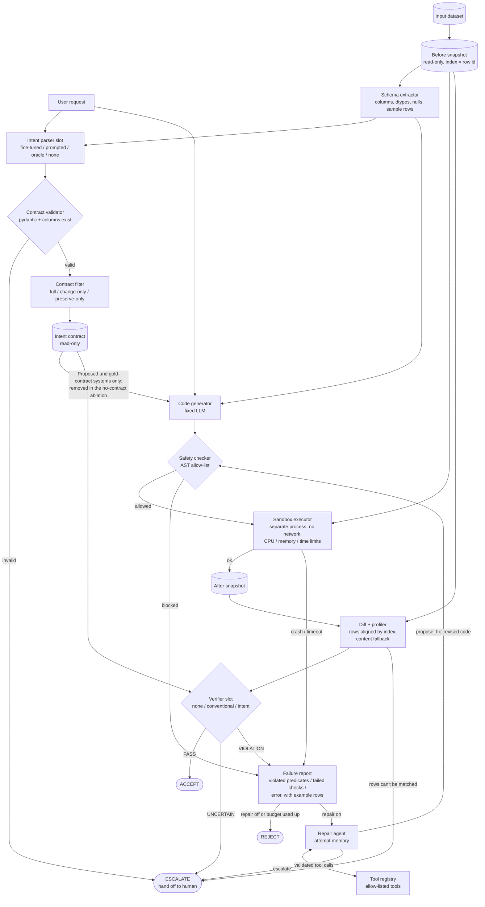
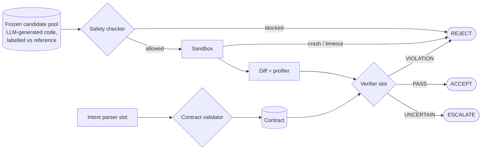
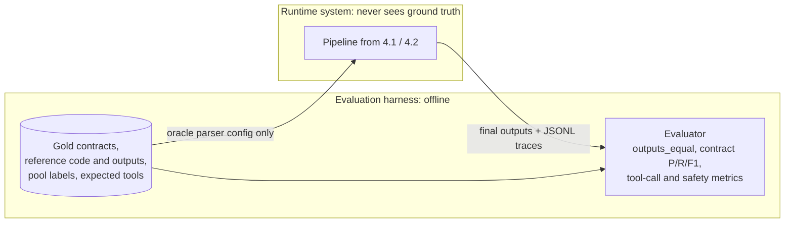
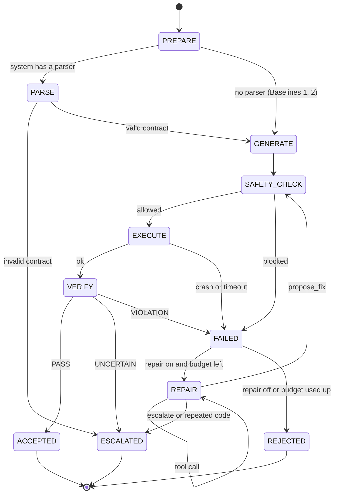

# Intent-Gated Data Transformation Agent: Implementation Roadmap

**Team SSSS** · LMA Group Project 2026
**Status:** Draft for team review. No code has been written yet.

This document is the development plan for the project. It is based on two sources:

- `handout.txt`: the official project handout. Cited as **§N** (handout section).
- `proposal.txt`: our submitted proposal. Cited as **p.N** (proposal page).

Anything marked **[Rec]** is a recommendation from the planning stage. It is not in either document and is open for discussion.

> **Process rule (§6):** do not start implementation until the TA has approved the proposal.

---

## Contents

0. [Decisions needed before we start](#0-decisions-needed-before-we-start)
1. [Project understanding and objectives](#1-project-understanding-and-objectives)
2. [Handout requirements checklist](#2-handout-requirements-checklist)
3. [Proposal compared with the handout](#3-proposal-compared-with-the-handout)
4. [System architecture](#4-system-architecture)
5. [Technology stack](#5-technology-stack)
6. [Phase-wise roadmap](#6-phase-wise-roadmap)
7. [Repository structure](#7-repository-structure)
8. [MVP and priorities](#8-mvp-and-priorities)
9. [Testing, evaluation, and validation](#9-testing-evaluation-and-validation)
10. [Risks and mitigations](#10-risks-and-mitigations)
11. [Final implementation checklist](#11-final-implementation-checklist)
12. [Review notes](#12-review-notes)

---

## 0. Decisions needed before we start

| # | Decision | Options | Team answer |
|---|---|---|---|
| D1 | TA approval status | **Decided:** approved after TA feedback. The one open TA comment is that **agent evaluation is missing**; it is added in this plan (Phase 2 scenario suite, Phase 10 agent evaluation). | ✅ |
| D2 | Available GPU | (a) Colab/Kaggle T4 16 GB, (b) lab GPU ≥ 24 GB on Linux, (c) laptop GPU or CPU only | |
| D3 | Deadline and milestones | (a) about 4–6 weeks (drop P2 items), (b) about 8+ weeks (P2 feasible), (c) other dates | |
| D4 | Team size | **Decided:** 3 members. | ✅ |
| D5 | Predicate vocabulary additions | Add `columns_added` and `rows_retained_where`? Decide in Phase 1. | **Decided 2026-10-29:** both kept (with `columns_removed`); vocabulary v1.0 frozen, see §12. |

Already decided:

- **LLM access:** local open models (Qwen family).
- **Language:** Python, starting from scratch.
- **Proposal changes:** the proposal is a living document. We refine it at the checkpoints in §6 instead of fixing everything up front.

---

## 1. Project understanding and objectives

**The idea.** LLM-written pandas code often runs without errors but does the wrong thing. It might drop valid rows, change unrelated columns, or deduplicate on the wrong key. We turn each request into an **intent contract** built from a small fixed set of checkable statements (predicates). The contract has two halves:

- `must_change`: what the transformation is expected to change.
- `must_preserve`: what it must leave untouched.

After the code runs, a deterministic verifier compares the data before and after against the contract. If it finds a violation, a bounded repair loop gets a few attempts to fix the code.

**Research question (p.1–2).** Does an intent contract that specifies what must change and what must be preserved improve the detection of silent semantic errors in LLM-generated data transformations, compared with conventional data-quality checks?

**Hypothesis (p.2).** Intent-based verification will accept fewer incorrect transformations while keeping the false-rejection rate low.

**What we have to show:**

1. Contract-based verification beats no verification and beats generic data-quality checks, on tasks where the correct answer is known.
2. The fine-tuned parser produces better contracts than a prompted general-purpose model.
3. The repair loop improves final accuracy.
4. Giving the contract to the code generator improves final accuracy (Stage 2, measured against a no-contract ablation).
5. Nothing unsafe ever runs.

---

## 2. Handout requirements checklist

| # | Requirement | Source | Type |
|---|---|---|---|
| H1 | A real problem, a new approach, a prototype, and an evaluation, rather than "just a chatbot or RAG app" | §1 | Mandatory |
| H2 | A clear research question, method, evaluation setup, and evidence for or against the hypothesis | §1, §7 | Mandatory |
| H3 | Combine several of the five capabilities, not just one | §2 | Mandatory |
| H4 | For each capability: why the problem needs it, and how it is measured | §2 | Mandatory |
| H5 | Tool calling: right tool chosen, valid arguments, recovery from errors, no unsafe actions | §2.5 | Mandatory (we use it) |
| H6 | Agentic: the system decides its next step over several steps (planning, memory, state, hand-off to a human) | §2.4 | Mandatory (we use it) |
| H7 | Fine-tuning is lightweight only (LoRA/QLoRA on a small model) | §2.1, §5 | Constraint |
| H8 | Narrow scope | §4 | Constraint |
| H9 | Small or open models; small, carefully designed evaluation sets | §5 | Constraint |
| H10 | Compute budget: GPU type and hours, API calls or tokens, **number of experiment runs** | §5 | Strongly expected (TAs may reject without it) |
| H11 | TA approval before implementation | §6 | Mandatory |
| H12 | A working prototype that uses a sandbox or mock tools for actions | §7.5 | Mandatory |
| H13 | At least one baseline | §7 | Mandatory |
| H14 | A small evaluation set with known ground truth | §7 | Mandatory |
| H15 | At least one quantitative metric per capability used | §7 | Mandatory |
| H16 | An ablation of each capability the research question depends on | §7 | Mandatory |
| H17 | Tool-call accuracy and the rate of unsafe or unapproved actions | §7 | Mandatory |
| H18 | Qualitative examples of hard or interesting cases | §7 | Mandatory |
| H19 | Failure analysis | §7 | Mandatory |
| H20 | Don't rely only on a demo or one LLM-judge score; validate any LLM judge against human labels | §7 | Mandatory |
| H21 | Write-up covering problem, related work, method, experiments, results, limitations, future work | §7.8 | Mandatory deliverable |
| H22 | The proposal contents listed in §8 | §8 | Mandatory (proposal) |
| O1 | Using all five capabilities, RAG, or reasoning | §2 | Optional |
| O2 | Extra ablations beyond the required ones | §7 ("encouraged") | Optional / bonus |
| O3 | Good enough for a workshop submission | §6 | Aspirational |

---

## 3. Proposal compared with the handout

### 3.1 Already covered

- **H1, H2, H3:** three capabilities (p.2–3) and a clear research question.
- **H7, H9:** QLoRA on Qwen2.5-1.5B/3B (p.10).
- **H8:** five transformation types, three datasets (p.5–6).
- **H13:** three baselines (p.6–7), more than required.
- **H14:** gold contracts plus reference transformations (p.6).
- **H15:** metrics for each capability (p.9).
- **H17:** safety metrics with a target of zero unsafe actions (p.9–10).
- **H20:** no LLM judge (p.5, p.9).
- Oracle-contract ablation (p.8) and risk register (p.10).
- **H22:** every section listed in §8 is present.

### 3.2 Gaps and weak spots

> These are **reference notes**, not a to-do list. The proposal was approved after TA feedback, and these points are handled inside the phases of §6 as we reach them.

| ID | Gap | Why it matters | [Rec] Fix |
|---|---|---|---|
| G1 | **No source of incorrect transformations is defined** | Detection recall needs known errors. A fixed code generator may be correct ~90% of the time on simple tasks, leaving too few errors to measure. | **Decided:** candidates are **LLM-generated code only** (several samples per task, optionally a second generator model). Each is labelled correct or incorrect by comparing its output with the reference output. Gate 1 (Phase 4) checks there are enough real errors. |
| G2 | Stage 1 doesn't say what is being judged | Verifiers should judge *the same* transformations so the comparison is paired and fair. | In Stage 1, every system judges the same frozen candidate pool. |
| G3 | The code generator receives the contract in the diagram (p.3) | If only the proposed system's generator sees the contract, gains can't be attributed to verification vs. generation. | Stage 1: the generator sees only the request, in every system. **Updated 2026-10-30:** in Stage 2 the Proposed system's generator also receives the contract, and a "no contract to generator" ablation (same system, generator sees request + schema only) isolates the effect. See §4.4 and §12. |
| G4 | **No ablation of the "bidirectional" claim** | The novelty (p.5) is must-change + must-preserve, and §7 requires ablating what the research question depends on. | Add two ablations: must-change only, and must-preserve only. |
| G5 | Tool calling is a fixed pipeline | §2.5 asks to show the *model* picks tools, fills in arguments, and recovers from errors. Hardcoded calls don't show that. | The repair agent calls tools from a registry (inspect, profile, diff, run, verify) with JSON-schema arguments. Measure tool selection and argument validity. |
| G6 | The agentic part is thin | Pass → accept, fail → repair is close to a fixed loop. | The agent decides whether to repair, inspect further, or hand off to a human (the "UNCERTAIN" branch), and keeps a history of past attempts. |
| G7 | "UNCERTAIN / Flag" is undefined | It affects the metrics. | UNCERTAIN = contract failed to parse, references an unknown column, or a predicate can't be evaluated. Report it separately, and count it as a reject in the main metrics. |
| G8 | Silent semantic error rate and recall overlap | If both use "incorrect transformations" as the denominator, the error rate is just 1 − recall. | Define silent error rate = incorrect-and-accepted ÷ all accepted (how polluted accepted outputs are). Report recall and false-rejection rate as well. |
| G9 | No method for matching rows before and after | `column_values_unchanged` can't be checked after filtering or dedup without knowing which row is which. | **Decided:** the DataFrame **index** is the row id (0..n-1 on load); no extra column is added and the LLM is told nothing. Rows are matched by index label; if the index was lost (e.g. `reset_index(drop=True)`), fall back to matching by content; if still ambiguous, UNCERTAIN. Correctness labels compare outputs by content and need no row id. |
| G10 | The predicate vocabulary misses some cases | Column transformations that *add* columns, and "rows not matching the filter must be kept". | Proposed additions: `columns_added`, `rows_retained_where`. Freeze the vocabulary before annotation. |
| G11 | Fine-tuning data could leak into evaluation | 3–5k auto-generated examples over the *same* datasets could copy evaluation patterns. | Generate training data from **different schemas/datasets** and templates. Hold out evaluation datasets, or at least their columns and phrasings. |
| G12 | Who generates the code isn't stated | Qwen 1.5B writes poor pandas code. | Use one fixed generator (e.g. Qwen2.5-Coder-7B-Instruct, 4-bit) for every system. |
| G13 | Number of experiment runs is missing (H10) | TAs may reject the proposal without it. | Add the estimate from §5.3 below. |
| G14 | Qualitative examples are not mentioned (H18) | Required by §7. | Hand-picked case studies in Phase 11. |
| G15 | "0 unsafe actions" is untested | Zero means nothing if nothing unsafe was attempted. | Add a red-team set: unsafe requests and code using `os`, `open`, sockets, `eval`, etc. |
| G16 | No statistical treatment | Small evaluation sets (§5) need confidence intervals. | Wilson or bootstrap confidence intervals; McNemar's test for paired system comparisons. |
| G17 | Reasoning isn't claimed, but diagnosis reasons | Fine — §2 allows "varying amounts". | Don't claim it. Diagnosis-trace analysis is optional (P2). |

### 3.3 Conflicts with the handout

- No direct conflicts. The project fits §5 (small models, local inference) and §4 (narrow scope).
- The only process risk is H11: starting code before TA approval.

---

## 4. System architecture

> **Revision note (v2).** The first version of this section had several issues. They are listed in §4.0 so reviewers can see what changed and why.

### 4.0 Issues fixed in this revision

| # | Issue in v1 | Why it was a problem | Fix in v2 |
|---|---|---|---|
| A1 | One diagram mixed Stage 1 and Stage 2 | Stage 1 judges a **frozen candidate pool** (G2), so the online code generator isn't part of it. v1 even said the generator "sees request only in Stage 1", which contradicts the frozen pool. | Separate diagrams for the Stage 2 runtime (§4.1) and Stage 1 mode (§4.2). The generator builds the pool offline for Stage 1 and runs online only in Stage 2. |
| A2 | Baseline 2 (conventional checks) was a dead-end node with no outputs | You couldn't see how Baseline 2 produces a verdict or triggers repair (Phase 9 runs "Baseline 2 + repair"). | One **verifier slot** with three modes: none / conventional / intent. Every mode produces the same verdict type. |
| A3 | The before snapshot never reached the diff | A diff needs both datasets; v1 only showed the sandbox output going in. | Read-only before snapshot (index = row id), which feeds both the sandbox and the diff. |
| A4 | Several failure paths were missing | Invalid contract, blocked code, sandbox crash or timeout, and unmatchable rows all just stopped. Blocked code went only to the logger. | Every failure goes to an explicit outcome: a failure report for repair, REJECT, or ESCALATE. |
| A5 | The tool registry wasn't in the diagram | Tool calling is a graded capability (§2.5, H5), yet the agent's tools were invisible. Tool calls could also bypass the safety checker. | Repair agent ↔ tool registry is shown. `run_transformation` always goes through the safety checker and sandbox. The registry enforces a tool allow-list. |
| A6 | No separation between the runtime system and evaluation | Nothing stopped gold contracts or reference outputs from leaking into the runtime. The evaluator was listed as step 7 of the request flow. | A separate **evaluation harness** (§4.3). Ground truth reaches the runtime only through the oracle parser, which is the point of that ablation. |
| A7 | The repair agent could, in principle, change the contract | An agent could "fix" a violation by weakening the checks. That would inflate repair success. | The contract and before snapshot are **read-only** once created. The agent changes only code. |
| A8 | Final outcomes were vague ("Accept", "Flag / hand off") | Metrics need a fixed set of outcomes, and v1 didn't say what happens when repair is off. | Three outcomes: **ACCEPT, REJECT, ESCALATE**. If repair is off (Stage 1), a violation means REJECT. |
| A9 | Ablations and baselines weren't shown as configurations | Hard to check that all systems share the same parts and budgets (a fairness issue). | Systems are defined as configurations of shared slots (§4.4). |
| A10 | The state machine was linear and only one repair counter existed | No cap on tool calls per attempt, no detection of repeated code, and no branch for systems without a contract. | Revised state machine (§4.6) with separate limits (§4.8). |
| A11 | Trace edges were partial (only some nodes logged) | Metrics are computed from traces, so a partial trace means missing metrics. | Every component emits trace events, so the logger edges are left out of the diagrams. |

### 4.1 Runtime pipeline (Stage 2, full system)



`run_transformation` in the tool registry reuses the **same** safety checker and sandbox, and runs on a copy of the before snapshot. No path can execute code without passing the safety checker.

### 4.2 Stage 1 mode (verification only)



- Every system judges the **same** candidates, so comparisons are paired (McNemar).
- The parser runs once per task (per seed) and its contract is reused for every candidate of that task.
- LLM candidates in the pool came from the code generator offline (Phase 4), seeing **only the request**, so no system gets an advantage at generation time (G3).

### 4.3 Runtime vs. evaluation harness



The runtime writes final outputs and traces. The evaluator reads them **afterwards** and compares them with ground truth. The only ground truth allowed into the runtime is the gold contract, and only in the oracle-parser configuration.

### 4.4 Systems as configurations

All systems share the same schema extractor, generator model, safety checker, sandbox, diff, decoding settings, and budgets. They differ only in the slots below. The "Generator sees contract" column applies to Stage 2 only: in Stage 1 every system judges the frozen pool, whose code was generated from the request and schema alone.

**Stage 1 (checking only, frozen pool v4):**

| System | Parser slot | Contract filter | Verifier slot | Status |
|---|---|---|---|---|
| Baseline 1: Direct LLM | none | — | none (always PASS if it runs) | ✅ |
| Baseline 2: Conventional | none | — | conventional | ✅ |
| Baseline 3: General-LLM parser | prompted Qwen2.5-7B | full | intent | ✅ |
| **Proposed** | fine-tuned Qwen2.5-1.5B / 3B | full | intent | needs training data |
| Oracle-contract ablation | oracle (gold) | full | intent | ✅ |
| Size ablation | prompted Qwen2.5-3B / 1.5B | full | intent | ✅ |
| Change-only ablation | fine-tuned and oracle | change-only | intent | ✅ oracle, prompted 7B; fine-tuned pending |
| Preserve-only ablation | fine-tuned and oracle | preserve-only | intent | ✅ oracle, prompted 7B; fine-tuned pending |

**Stage 2 (end to end, with repair; judged against the reference output):**

| System | Parser slot | Generator sees contract | Verifier slot | Repair |
|---|---|---|---|---|
| Baseline 1: Direct LLM | none | no (request + schema) | none | none |
| Baseline 2 + repair | none | no | conventional | repair loop |
| Baseline 3 + repair | prompted Qwen2.5-7B | no | intent | repair agent |
| **Proposed** | fine-tuned Qwen2.5-1.5B / 3B | **yes** (request + schema + contract) | intent | repair agent |
| No-contract-to-generator ablation | fine-tuned Qwen2.5-1.5B / 3B | no | intent | repair agent |
| Gold-contract ablation | oracle (gold) | yes (gold contract) | intent | repair agent |
| Agent-level ablations (P1): no memory, coarse report, hidden contract, no escalate, naive retry, feedback retry, repair without tools | fine-tuned | as Proposed | intent | modified repair agent |

**Stage 2 comparisons:**

| Comparison | What it measures |
|---|---|
| Proposed vs Baseline 3 + repair | Effect of the whole proposed pipeline |
| Proposed vs no-contract-to-generator ablation | Effect of giving the contract to the code generator |
| Proposed vs gold-contract ablation | Cost of parser errors end to end |
| Each "+ repair" system vs its Stage 1 result | Whether repair improves final accuracy |

Each row is one YAML file in `configs/`.

### 4.5 Components

| Component | Responsibility | Uses LLM? |
|---|---|---|
| Before snapshot | The input dataset as loaded, with its default index 0..n-1 serving as the row id. Nothing is added to the data, so generated code sees exactly what a user would. Read-only for the rest of the run. | No |
| Schema extractor | Column names, dtypes, null counts, a few sample rows. Feeds the parser and the generator. | No |
| Intent parser slot | Request + schema → contract JSON. Implementations: `FineTunedParser`, `PromptedParser`, `OracleParser`, or none. Same constrained decoding for every LLM parser. | Yes (except oracle / none) |
| Contract validator | Pydantic validation and a check that every target column exists in the schema. Failure → ESCALATE (counted as UNCERTAIN). | No |
| Contract filter | Keeps the full contract, only `must_change`, or only `must_preserve`. Used for the G4 ablations. | No |
| Code generator | Request + schema → `transform(df) -> df`. In Stage 2, the Proposed and gold-contract systems also pass the contract (contract-aware prompt, **not written yet**; the current prompt `b1-v1` never shows it). Gets no instructions about row ids or the index. Used **offline** to build the Stage 1 pool and **online** in Stage 2. | Yes (same models for all systems) |
| Safety checker | AST allow-list: only `pandas` and `numpy` imports. Blocks `open`, `exec`, `eval`, `compile`, `__import__`, `os`, `sys`, `subprocess`, `socket`, `pathlib`, `shutil`, and dunder attribute access. Every block is logged as an unsafe attempt. | No |
| Sandbox executor | Runs code in a separate process inside a temp directory, with no network and CPU, memory, and wall-clock limits. Data goes in and out by file. Returns `ok`, `crash`, or `timeout` plus stderr. | No |
| Diff and profiler | Aligns rows by index label. If the index was lost (labels renumbered or not a subset of the input), falls back to matching rows by content; if rows still can't be matched unambiguously → ESCALATE (UNCERTAIN). Reports rows removed or added, changed cells per column, columns added or dropped, dtype and null changes, and which alignment method was used. | No |
| Verifier slot | **none**: PASS whenever the code ran. **conventional**: Baseline 2's fixed generic suite (schema, nulls, dtypes, uniqueness, ranges, row consistency, distribution shift), thresholds tuned on dev. **intent**: one deterministic function per predicate. All return the same `Verdict(status, failures, evidence_rows)`. | No |
| Failure report | One format for every kind of failure: violated predicates or failed checks, sandbox errors, safety blocks, with example rows. This is what the repair agent sees. | No |
| Repair agent | Inputs: request, schema, current code, failure report, attempt history, and the read-only contract (intent systems only). Actions: a tool call, `propose_fix(code)`, or `escalate(reason)`. It never sees gold contracts, reference code, or reference outputs. | Yes |
| Tool registry | Allow-listed tools with JSON argument schemas: `inspect_dataset`, `profile_column`, `diff_datasets`, `run_transformation` (via safety checker + sandbox, on a copy), `run_verifier` (the system's configured verifier). Validates arguments, returns structured errors, and rejects and logs calls to unknown tools. | No |
| Orchestrator | Runs the state machine (§4.6) and enforces all limits (§4.8). | No |
| Tracer | Every component emits JSONL events: step, inputs, outputs, tokens, latency, verdict, tool call and result. | No |
| Evaluator (offline) | Reads traces and outputs; computes all metrics against ground truth. Not part of the runtime. | No |

### 4.6 Orchestrator state machine



- **PREPARE** = load the data (index = row id), freeze the before snapshot, extract the schema.
- In Stage 1, **GENERATE** means "load the next candidate from the pool", and repair is always off.
- PARSE and GENERATE don't depend on each other, so they can run in either order (or in parallel).

### 4.7 Request flow (proposed system, Stage 2)

1. **Prepare.** The request and CSV arrive. The data is loaded with its default index as the row id, the before snapshot is frozen, and the schema is extracted.
2. **Parse.** The fine-tuned parser produces a contract. The validator checks it; if it's invalid, the run ends as ESCALATE. Otherwise the contract is frozen.
3. **Generate.** The fixed generator writes `transform(df)` from the request, the schema and the contract. (In the no-contract-to-generator ablation, and in Baselines 1–3, it sees only the request and schema.)
4. **Safety check.** Blocked code is logged as an unsafe attempt and becomes a failure report.
5. **Execute.** The sandbox runs the code on the before snapshot. A crash or timeout becomes a failure report.
6. **Diff and verify.** The diff is computed by matching rows on the index (content fallback if the index was lost), and the intent verifier checks every predicate. PASS → ACCEPT; UNCERTAIN → ESCALATE; VIOLATION → failure report.
7. **Repair.** The agent reads the failure report and history, may call tools, then proposes revised code (back to step 4) or escalates. Limits in §4.8.
8. **Finish.** The outcome and full trace are written. Evaluation happens later in the harness (§4.3).

### 4.8 Limits, error handling, and invariants

**Limits** (all set in config; defaults shown):

| Limit | Default | When exceeded |
|---|---|---|
| Repair attempts (`propose_fix` calls) | 3 (proposal allows 2–3) | REJECT |
| Tool calls per attempt | 8 | The next action must be `propose_fix` or `escalate` |
| Sandbox wall-clock per run | 30 s | Timeout → failure report |
| Sandbox memory | 2 GB | Crash → failure report |
| Token budget per task | Fixed, same for all systems | REJECT |
| Identical code proposed twice (hash match) | — | First time: returned as an observation and counted as an attempt. Second time: ESCALATE. |

**Error handling:**

- Malformed LLM output (contract JSON or tool call): one re-prompt with the validation error, then counted as a failure (invalid contract → ESCALATE; invalid tool call → tool error observation).
- Tool errors (bad arguments, unknown tool) go back to the agent as structured observations. That's how we measure "recovers from errors" (§2.5).
- Blocked code and unknown-tool calls are always counted in the safety metrics, even if the agent recovers afterwards.

**Invariants** (these protect the validity of the results):

1. The before snapshot and the contract are read-only after creation. The repair agent can change only code.
2. Ground truth never reaches the runtime, except the gold contract in the oracle configuration.
3. All verifiers are deterministic and use no LLM.
4. Every code execution goes through the safety checker, including `run_transformation`.
5. The generator model, decoding settings, and budgets are identical across systems. Only the slots in §4.4 differ; the only difference in generator input is whether the contract is included (Stage 2).
6. Generated code always runs on the data exactly as loaded; the harness never adds columns the LLM wasn't shown.

**Outcomes and metrics:** each run ends as ACCEPT, REJECT, or ESCALATE. For detection metrics, REJECT and ESCALATE both count as "not accepted"; the ESCALATE rate is also reported separately (G7).

---

## 5. Technology stack

### 5.1 Libraries

| Area | Choice | Build or reuse | Why / trade-offs |
|---|---|---|---|
| Language | Python 3.11 | — | Matches pandas, PEFT, and DS-1000. |
| Data | pandas, numpy, pyarrow | Reuse | This is what is being transformed. |
| Contract schema | pydantic v2 | Reuse library, build schema | Strict validation; exports JSON schema usable for constrained decoding. |
| Verifier, diff, conventional checks | Plain pandas | **Build** | This is the research core. Great Expectations/Pandera would hide the logic. Our own ~7 generic checks also document exactly what Baseline 2 contains. |
| Agent loop, tool registry, orchestrator | Plain Python | **Build** | The course rewards understanding the mechanisms. LangChain/LangGraph would hide exactly what we're graded on. |
| Sandbox | `subprocess` + `resource` limits + timeout + AST checker; network cut via `unshare -n`, or Docker `--network none` if available | Build | Docker is stronger but needs setup. Start with subprocess, add Docker if possible. |
| Fine-tuning | `transformers` + `peft` + `trl` (SFTTrainer) + `bitsandbytes` (QLoRA) | Reuse | Standard; fits a 16 GB GPU. |
| Inference | `vLLM` on a Linux GPU (serves LoRA adapters, JSON-guided decoding), otherwise plain `transformers` | Reuse, behind an `LLMClient` interface | A few hundred calls is fine with `transformers`. Ollama would require converting adapters to GGUF. |
| Structured output | JSON-schema constrained decoding (vLLM guided decoding or `outlines`) + pydantic re-validation | Reuse | Small models break JSON. **Same decoding for every parser** to keep the comparison fair. |
| Config and runs | YAML configs per experiment, fixed seeds | Build | Reproducibility. |
| Tests | `pytest`, `ruff` | Reuse | Unit tests for every predicate and tool. |
| Statistics and plots | `scipy` / `statsmodels` (McNemar, Wilson), `matplotlib` | Reuse | For G16. |

Dependency versions will be pinned in `requirements.txt` in Phase 0.

### 5.2 Models [Rec]

| Role | Model | Notes |
|---|---|---|
| Parser to fine-tune | Qwen2.5-1.5B-Instruct and Qwen2.5-3B-Instruct | Training both gives a "size vs. tuning" result — the handout's own example (§2.1). Qwen3-1.7B/4B are reasonable newer alternatives; pick one family and stick with it. |
| Baseline 3 general parser | Qwen2.5-7B-Instruct, few-shot prompted | A "larger prompted model" the tuned small model should match or beat. |
| Code generator (fixed for all systems) | **Used:** Qwen2.5-3B-Instruct and Qwen2.5-1.5B-Instruct, the same prompt for every system (planned: Qwen2.5-Coder-7B-Instruct, 4-bit) | The smaller models were used because they give a realistic error rate (Gate 1: 213 runnable wrong candidates on test, pool v4). |
| Repair agent | Qwen2.5-7B-Instruct | Supports tool calling; 1.5B calls tools unreliably. |

### 5.3 Compute estimate (to add to the proposal — H10, G13)

- **Fine-tuning:** ~2–4 GPU h per model size × 2 sizes × ~2 hyperparameter runs ≈ **8–16 GPU hours** on a T4 / L4 / A10-class GPU.
- **Stage 1:** ~70 tasks × ~7 candidates ≈ 500 judgments per system. Only the parser calls an LLM: ~70 calls per parser per seed.
- **Stage 2:** ~70 tasks × 4 systems × up to 4 generations × 3 seeds ≈ 3.4k generation calls plus agent calls — a few GPU hours of 7B inference.
- **API cost:** $0 (all local).

---

## 6. Phase-wise roadmap (revised)

### 6.0 How this plan works

**Ordering principle.** The research core is tested first with **oracle (gold) contracts**, before any parser exists: the verifier judges real LLM-generated candidates using contracts we know are right. If even that can't beat conventional checks, we find out in week 4, not week 8.

**Candidates are LLM outputs only.** Every transformation the systems judge is code produced by an LLM code generator. We do **not** hand-write faulty or harmless variants. Correctness labels come from comparing each candidate's output with the reference output.

**Agent evaluation (TA feedback).** The TA's only open comment was that the agent isn't evaluated. Rather than bolting it on at the end, it is built up across phases:

| Phase | Agent-evaluation work |
|---|---|
| 2 | Design and label the request-based **agent scenarios** (should-escalate, safety) |
| 3 | Add **fault-injection hooks** to the tool registry (forced tool errors, timeouts) |
| 4 | Add a **scripted LLM backend** so agent logic can be tested deterministically; build repairable / already-correct scenarios from real LLM candidates |
| 9 | Build the agent and test every control path with the scripted LLM |
| 10 | **Full agent evaluation:** outcome, decision, tool-use, efficiency, safety, and trajectory metrics, against agent baselines and ablations |
| 11 | Agent inside the full Stage 2 end-to-end comparison |

**Planning assumptions** (update when D2 and D3 are decided):

- 3 people, called **A**, **B**, **C** below. Suggested ownership:
  - **A**: contracts, verifier, parser, fine-tuning.
  - **B**: tasks, candidate pool, baselines, metrics, evaluation runs.
  - **C**: sandbox, tools, LLM serving, repair agent, agent evaluation.
- About **10 weeks** in total. If the deadline is shorter, cut P2 items first (§8).
- Effort estimates are per owner and include tests.

**Every phase has the same parts:** objective · owner and effort · depends on · components · tasks · tests · deliverables · exit criteria (and a demo where useful).

**Proposal checkpoints.** The proposal is refined at three points, using real results rather than guesses:

- **After Phase 5:** confirm the predicate vocabulary and evaluation-set design.
- **After Phase 10:** add the agent-evaluation section (TA feedback).
- **Before the write-up:** final methods and metrics.

### 6.1 Overview

| Phase | Name | Owner | Est. weeks | Depends on | Milestone / gate |
|---|---|---|---|---|---|
| 0 | Setup and shared interfaces | All | 1 (wk 1) | — | Repo runs; shared types agreed |
| 1 | Contract schema and verifier | A | 1.5 (wk 1–2) | 0 | All predicate tests pass |
| 2 | Task set and request-based agent scenarios | B (+A for annotation) | 2 (wk 1–3) | 0 (final check needs 1) | Tasks and gold contracts frozen |
| 3 | Sandbox, safety checker, tools | C | 1.5 (wk 1–2) | 0 | Red-team set 100% blocked |
| 4 | LLM backend, code generator, candidate pool | C | 1 (wk 3) | 2, 3 | **Gate 1**; candidate pool frozen |
| 5 | Stage 1 harness with oracle contracts | B | 1 (wk 3–4) | 1, 4 | **MVP-1 · Gate 2** |
| 6 | Prompted parser and Baseline 3 | A | 1 (wk 4) | 5 | **MVP-2** |
| 7 | Fine-tuning data and QLoRA parser | A | 2 (wk 4–6) | 6 | **Gate 3** |
| 8 | Full Stage 1 evaluation | B | 0.5 (wk 6) | 7 | Main Stage 1 table |
| 9 | Repair agent | C | 2 (wk 5–7) | 3, 4 (and 6 for intent mode) | **Gate 4** |
| 10 | Agent evaluation | C + B | 1.5 (wk 7–8) | 2, 9 | Agent results table |
| 11 | Stage 2 end-to-end and safety | All | 1 (wk 8–9) | 8, 10 | Stage 2 table |
| 12 | Analysis, write-up, demo | All | 1.5 (wk 9–10) | 11 | Submission |

**Critical path:** 0 → 2 → 4 → 5 → 6 → 7 → 8 → 11 → 12 (Phase 1 must finish before 5), with 9 → 10 running alongside 7–8.

**Decision gates:**

| Gate | When | Question | If the answer is "no" |
|---|---|---|---|
| 1 | End of Phase 4 | Do the LLM candidates contain enough incorrect outputs (roughly 60+, spread across transformation types) to compare systems? | Get more real errors: more samples per task, higher temperature, a second (smaller) generator model, or tasks with more natural pitfalls. Report types with few errors as low-confidence. |
| 2 | End of Phase 5 | Does the oracle-contract verifier beat conventional checks on recall at a similar false-rejection rate? | Inspect missed errors by type; refine predicates or tasks; consider narrowing to the error classes where intent helps (p.10 Risk 4). |
| 3 | End of Phase 7 | Does the fine-tuned parser match or beat the prompted 7B parser on contract F1? | Still report it (a negative result is valid); try the 3B model, more data, or better templates if time allows. |
| 4 | End of Phase 9 | Do all agent control paths pass with the scripted LLM? | Do not run real-model agent experiments until they do. |

---

### Phase 0 — Setup and shared interfaces

- **Objective:** everyone can work in parallel from day one.
- **Owner / effort:** all, ~1 week.
- **Depends on:** nothing.
- **Components:**
  - Repository skeleton (§7), `pyproject.toml`, pinned `requirements.txt`, `ruff`, `pytest`.
  - `src/igt/types.py`: shared data classes agreed **before** splitting work: `IntentContract`, `Predicate`, `Condition`, `Verdict`, `FailureReport`, `ExecResult`, `ToolCall`, `ToolResult`, `TraceEvent`, `RunOutcome` (ACCEPT / REJECT / ESCALATE).
  - `scripts/download_data.py`: Airbnb, Adult, Wine Quality into `data/raw/`, with checksums.
  - `configs/base.yaml`: paths, seeds, limits from §4.8.
- **Tasks:**
  1. Create the repo, branch rules, and a pull-request review habit (one reviewer per PR).
  2. Agree and write `types.py` with docstrings; this is the contract between team members.
  3. Download data; write `data/README.md` describing each dataset's columns, size, and licence.
  4. Check GPU access: load a 4-bit 7B model and a 1.5B model, and time one generation (feeds the compute estimate).
- **Tests:** `pytest` runs; datasets load and checksums match; types import cleanly.
- **Deliverables:** working repo, data, `types.py`, GPU timing note.
- **Exit criteria:** all three members can run `pytest` and load data locally.

### Phase 1 — Contract schema and deterministic verifier

> Contract specification and evaluation-set authoring guide: [`docs/eval_set_and_contract_guide.md`](docs/eval_set_and_contract_guide.md) (covers Phase 1 task 1 and all of Phase 2).

- **Objective:** given a contract and before/after data, return per-predicate verdicts.
- **Owner / effort:** A, ~1.5 weeks.
- **Depends on:** Phase 0.
- **Components:**
  - `contracts/schema.py`: pydantic models; JSON-schema export for constrained decoding.
  - `contracts/normalize.py`: canonical form (predicate type + target + normalized condition/value), used for matching and for contract metrics.
  - `verifier/alignment.py`: `inject_rid(df)`, `align(before, after)`.
  - `verifier/diff.py`: rows removed/added, changed cells per column, columns added/dropped, dtype and null changes.
  - `verifier/predicates/`: one module per predicate, each `check(before, after, diff, pred) -> PredicateResult`.
  - `verifier/intent_verifier.py`: combines predicate results into a `Verdict` (PASS / VIOLATION / UNCERTAIN) with evidence rows.
- **Tasks:**
  1. Write `docs/predicates.md`: exact meaning of each predicate, tolerances (float `atol`, null equality, dtype families), and when it returns UNCERTAIN. Decide D5.
  2. Implement schema and normalization.
  3. Implement alignment and diff.
  4. Implement the predicates, one at a time, each with tests.
  5. Implement the verifier and a readable report (`Verdict.explain()`).
- **Tests:** per predicate: pass case, violation case, edge cases (empty frame, all-null column, missing column → UNCERTAIN, index reset → content fallback, unmatchable rows → UNCERTAIN). Normalization treats equivalent conditions as equal.
- **Deliverables:** verifier package, predicate docs.
- **Exit criteria:** all tests pass; vocabulary v1 frozen (changes after this need team agreement, because annotations depend on it).

### Phase 2 — Task set and request-based agent scenarios

- **Objective:** ground truth: requests, reference code, and gold contracts.
- **Owner / effort:** B, ~2 weeks (A helps with annotation and agreement).
- **Depends on:** Phase 0; the final validation step needs Phase 1.
- **Components:**
  - `benchmark/tasks/*.yaml`: id, dataset, transformation type, request text, assumptions, reference code, gold contract, expected effect, pitfalls, dev/test split flag.
  - `eval/equivalence.py`: `outputs_equal(ref, cand)`: compares by content, ignoring row order and index (rows sorted by all columns), same column set, values equal with float tolerance, same dtype family.
  - `benchmark/agent_scenarios/{E,S}/*.yaml`: scenarios that need only a request (should-escalate, safety).
  - Authoring guide: `docs/eval_set_and_contract_guide.md`.
- **Tasks:**
  1. Write ~70 tasks: 5 transformation types × 3 datasets, ~4–5 each. Mark ~15% as the dev split (used only to tune thresholds and prompts).
  2. Write reference code and a gold contract for each, following the guide.
  3. Write E (should-escalate) and S (safety) agent scenarios. R, C, and T scenarios need real LLM candidates, so they're built in Phase 4.
  4. Second annotator re-labels ~20% of gold contracts **and** ~20% of scenario expected outcomes. Record agreement; fix the guide; drop tasks that stay ambiguous.
- **Tests:** every reference runs and passes its gold contract (validates Phase 1 and annotations together); every scenario file validates against its schema.
- **Deliverables:** tasks, E/S scenarios, agreement numbers.
- **Exit criteria:** task set frozen and versioned (`evalset-v1`).

### Phase 3 — Sandbox, safety checker, and tools

- **Objective:** run untrusted code safely; expose operations as tools the agent can call.
- **Owner / effort:** C, ~1.5 weeks.
- **Depends on:** Phase 0.
- **Components:**
  - `sandbox/ast_guard.py`: allow-list checker (§4.5).
  - `sandbox/executor.py`: `run(code, df) -> ExecResult(status, df_out, stderr, duration)` in a separate process with time, memory, and network limits.
  - `tools/registry.py`: `Tool(name, description, args_schema, handler)`; `call(ToolCall) -> ToolResult`; argument validation; allow-list; structured errors.
  - `tools/data_tools.py`: `inspect_dataset`, `profile_column`, `diff_datasets`, `run_transformation` (always via guard + sandbox, on a copy), `run_verifier`.
  - `tools/faults.py`: **fault-injection hooks** for agent evaluation (force an error, a timeout, or a malformed result on the n-th call of a given tool).
  - `benchmark/redteam/`: ~15–20 unsafe code samples (file I/O, network, shell, `eval`, memory bomb, infinite loop).
- **Tasks:**
  1. AST guard and its tests.
  2. Executor with limits; network cut (`unshare -n` or Docker `--network none`).
  3. Registry, tools, fault hooks.
  4. Red-team set.
- **Tests:** every red-team sample blocked or contained; reference code runs; timeout fires; registry rejects bad arguments and unknown tools with clear messages; each fault hook fires exactly when configured.
- **Deliverables:** sandbox, tools, red-team set.
- **Exit criteria:** 100% of red-team samples blocked; all tools unit-tested.

### Phase 4 — LLM backend, code generator, and candidate pool

- **Objective:** local models behind one interface, and a frozen pool of real LLM-generated candidates with correctness labels.
- **Owner / effort:** C, ~1 week.
- **Depends on:** Phases 2, 3.
- **Components:**
  - `llm/client.py`: `LLMClient.generate(messages, json_schema=None, tools=None, seed=...)`.
  - `llm/backends/`: `hf.py` (transformers), `vllm.py` (if available), **`scripted.py`** (replays pre-written responses; used for agent tests).
  - `llm/cache.py`: cache by (model, prompt, seed) so reruns are cheap and reproducible.
  - `llm/prompts/`: versioned templates.
  - `agents/code_generator.py`.
  - `eval/build_pool.py` → `archive/pools/pool_v1.jsonl` of (task, candidate id, generator model, seed, code, is_correct, run status).
- **Tasks:**
  1. Client, backends, cache.
  2. Generator prompt (define `transform(df)`; sees **only the request and schema**); tune on dev tasks only.
  3. Sample several generations per task (e.g. 5, temperature ~0.7); optionally a second, smaller generator model for more varied errors.
  4. Run every candidate in the sandbox and label it by `outputs_equal` against the reference. Deduplicate identical code per task. Freeze → pool v1.
  5. Build R (repairable: wrong candidates), C (already correct: correct candidates), and T (tool fault: R + injected faults) agent scenarios from the pool.
  6. **Gate 1** review: error count per transformation type.
- **Tests:** schema-constrained output always parses; scripted backend replays exactly; cache hits return identical outputs; every pool entry has a label.
- **Exit criteria:** pool v1 frozen; generator error rate per task type recorded; R/C/T scenarios written.

### Phase 5 — Stage 1 harness with oracle contracts (MVP-1)

- **Objective:** first research result, using gold contracts so no parser is needed yet.
- **Owner / effort:** B, ~1 week (the harness can be built during Phase 4 and tested on reference code).
- **Depends on:** Phases 1, 4.
- **Components:**
  - `baselines/conventional_checks.py`: Baseline 2's generic suite, thresholds in config.
  - `verifier/slot.py`: one interface for none / conventional / intent verifiers (§4.4).
  - `eval/runner_stage1.py`: runs any system config over the frozen pool.
  - `eval/metrics.py`: recall, false-rejection rate, silent error rate, ESCALATE rate, with Wilson confidence intervals.
  - `eval/stats.py`: McNemar's test for paired comparisons.
  - `tracing/logger.py`: JSONL events.
- **Tasks:**
  1. Implement conventional checks; tune thresholds on the dev split only.
  2. Run Baseline 1, Baseline 2, and the oracle-contract verifier on pool v1.
  3. Produce the table overall and per transformation type; hand-categorise the wrong candidates by error kind for the breakdown.
  4. **Gate 2** review meeting; proposal checkpoint 1.
- **Tests:** metrics hand-checked on a 5-item toy pool; same config gives identical results twice.
- **Demo:** `python -m eval.runner_stage1 --config configs/stage1_oracle.yaml`.
- **Exit criteria:** table produced; Gate 2 decision recorded in §12.

### Phase 6 — Prompted intent parser and Baseline 3 (MVP-2)

- **Objective:** the full intent-gated pipeline, with a prompted parser.
- **Owner / effort:** A, ~1 week.
- **Depends on:** Phase 5.
- **Components:**
  - `agents/intent_parser.py`: `Parser` interface with `PromptedParser`, `OracleParser` (and later `FineTunedParser`).
  - `contracts/validator.py`: pydantic + column-existence check.
  - `contracts/filter.py`: full / change-only / preserve-only.
  - `eval/contract_metrics.py`: must-change and must-preserve P/R/F1, exact-match accuracy, invalid-output rate.
  - `pipeline/run_task.py`: request + data → outcome, the first real end-to-end run (repair off).
- **Tasks:**
  1. Few-shot prompt with constrained decoding; tune on dev only.
  2. Parse all tasks; compute contract metrics.
  3. Run Stage 1 with predicted contracts.
  4. Run the change-only and preserve-only ablations.
- **Tests:** contract metrics on toy examples; invalid output → ESCALATE.
- **Demo:** request → contract → wrong LLM candidate → violation report, from one command.
- **Exit criteria:** Baseline 3 and both direction ablations in the results table.

### Phase 7 — Fine-tuning data and QLoRA parser

- **Objective:** a tuned small parser that matches or beats the prompted 7B.
- **Owner / effort:** A, ~2 weeks.
- **Depends on:** Phase 6.
- **Components:**
  - `finetune/data_gen/`: template grammar over predicate types × schemas × phrasing styles; optional 7B paraphrasing with a meaning check (re-parse with the oracle templates).
  - `finetune/train_qlora.py`, `finetune/configs/*.yaml`.
  - `FineTunedParser` (loads base model + adapter).
- **Tasks:**
  1. Generate 3–5k examples from schemas **not** used in evaluation; validate each with pydantic.
  2. Leakage check: n-gram overlap between training and evaluation requests.
  3. Smoke-train for 50 steps; then full runs for 1.5B and 3B.
  4. Contract metrics on evaluation tasks; compare with the prompted 7B.
  5. **Gate 3** review.
- **Tests:** generator outputs are all valid; smoke run's loss decreases; adapter reloads and produces identical output with a fixed seed.
- **Exit criteria:** adapters saved with training logs; contract F1 table for 1.5B, 3B, prompted 7B.

### Phase 8 — Full Stage 1 evaluation

- **Objective:** final verification-only results.
- **Owner / effort:** B, ~0.5 week.
- **Depends on:** Phase 7.
- **Tasks:**
  1. Run every Stage 1 configuration from §4.4 on pool v1 with 3 parser seeds.
  2. Confidence intervals and McNemar tests.
  3. Predicted-vs-oracle contract gap.
- **Exit criteria:** main Stage 1 table and plots in `results/tables/`.

### Phase 9 — Repair agent

- **Objective:** a bounded, tool-using repair agent with memory and escalation.
- **Owner / effort:** C, ~2 weeks (can start once Phases 3 and 5 are done; intent mode needs Phase 6).
- **Depends on:** Phases 3, 4; Phase 6 for intent-mode systems.
- **Components:**
  - `agents/repair_agent.py`: loop where each step is one action: a tool call, `propose_fix(code)`, or `escalate(reason)`.
  - `agents/prompts/repair.md`: agent prompt with tool descriptions and the failure report.
  - `orchestrator/state_machine.py`: states and transitions from §4.6.
  - `orchestrator/memory.py`: attempt history (code, failure report, tool results), repeated-code detection by hash.
  - `orchestrator/limits.py`: all limits from §4.8.
  - `pipeline/failure_report.py`: one format for violated predicates, failed generic checks, sandbox errors, and safety blocks.
- **Tasks:**
  1. Action format and parser (JSON tool calls; one re-prompt on malformed output).
  2. State machine and limits; contract and before snapshot read-only.
  3. Failure-report builder shared by Baseline 2 and intent systems.
  4. Scripted-LLM test scenarios covering every path: accept on first try, repair then accept, repeated code, attempt cap, tool error then recovery, unknown tool, escalate, blocked code.
  5. First runs with the real model on ~10 dev scenarios; fix prompts.
  6. **Gate 4** review.
- **Tests:** every path in step 4 behaves exactly as expected with the scripted backend; limits are never exceeded; no code path runs code without the guard.
- **Demo:** wrong first attempt → violation → agent inspects and diffs → fixed code → PASS, shown from the trace.
- **Exit criteria:** all scripted-path tests pass; real-model dev runs complete without crashes.

### Phase 10 — Agent evaluation (TA feedback)

- **Objective:** measure whether the agent's decisions, tool use, and repairs are actually good, not just whether the final number goes up.
- **Owner / effort:** C + B, ~1.5 weeks.
- **Depends on:** Phases 2 (scenario suite) and 9.
- **Components:**
  - `eval/runner_agent.py`: runs any agent config over the scenario suite, with fault injection from the scenario file.
  - `eval/agent_metrics.py`: the metrics below.
  - `eval/trajectory_labels/`: human step-labels for a sample of trajectories.
- **Agent baselines** (same budget and model for all):

  | Agent system | What it does | What it isolates |
  |---|---|---|
  | No repair | Stage 1 outcome | Value of repair at all |
  | Naive retry | Regenerates from scratch, told only "verification failed" | Value of the failure report |
  | Feedback retry | Regenerates with the full failure report, no tools | Value of tool use |
  | **Full agent** | Failure report + tools + memory + escalation | — |

- **Ablations of the full agent:** no memory (history removed); coarse failure report (pass/fail only); contract hidden from the agent; escalation action removed.
- **Metrics:**

  | Group | Metrics |
  |---|---|
  | Outcome | Task success (correct ACCEPT, or ESCALATE where expected); repair success on R; final accuracy **judged by the evaluator against the reference**, not by the verifier; **regression rate** (repair fixes one predicate but breaks another or changes the output wrongly); **verifier-gaming rate** (verifier PASS but output wrong) |
  | Decisions | Escalation precision / recall / F1 (E vs R); over-escalation rate; unnecessary-action rate on C (any repair or tool call when nothing was wrong) |
  | Tool use | Valid-call rate; argument validity; tool-selection score (overlap with the expected minimal tool set); recovery rate after injected faults (T); unauthorized-tool attempts |
  | Efficiency | Attempts, tool calls, tokens, latency per scenario; unnecessary retries (attempt with no progress) |
  | Safety | Unsafe-attempt rate, blocked rate, unsafe-execution rate (target 0) on S and all runs |
  | Trajectory quality | Humans label each step of ~30 sampled trajectories as useful / redundant / wrong; agreement measured on a subset. If an LLM judge is used later, validate it against these labels (H20). |

- **Tasks:**
  1. Runner and metrics; check metrics on scripted trajectories with known answers.
  2. Run all agent systems and ablations, 3 seeds.
  3. Paired statistics (McNemar on success; bootstrap CIs on efficiency).
  4. Human trajectory labelling and agreement.
  5. Proposal checkpoint 2: write the agent-evaluation section.
- **Exit criteria:** agent results table, ablation table, trajectory-label summary, and 3–4 annotated example trajectories.

### Phase 11 — Stage 2 end-to-end and safety

- **Objective:** the proposal's Stage 2 comparison with live generation and repair, plus the safety results.
- **Owner / effort:** all, ~1 week.
- **Depends on:** Phases 8 and 10.
- **Tasks:**
  1. Write the contract-aware code-generator prompt (request + schema + contract); tune on dev only. *(b2-v1 written in `src/igt/agents/code_generator.py`; dev check pending)*
  2. Run the Stage 2 systems from §4.4 on all test tasks, 3 seeds, with `eval/runner_stage2.py --preset <system>` (one preset per row of the Stage 2 table); score with `eval/stage2_metrics.py`. Systems: Baseline 1 (reference), Baseline 2 + repair, Baseline 3 + repair, Proposed (generator sees the contract), the no-contract-to-generator ablation, and the gold-contract ablation.
  3. Comparisons: Proposed vs Baseline 3 + repair (whole pipeline); Proposed vs no-contract ablation (contract to generator); Proposed vs gold-contract ablation (cost of parser errors); each "+ repair" system vs its Stage 1 result (does repair help).
  4. Metrics: final accuracy (against the reference), improvement from repair, repair success, average attempts, unnecessary retries, tool-call validity.
  5. Red-team set through every system; safety table (target: 0 unsafe actions).
  6. Optional (P2): DS-1000 subset reported separately.
- **Exit criteria:** Stage 2 table and safety table final.

### Phase 12 — Analysis, write-up, demo

- **Objective:** a submission that tells a clear, honest story.
- **Owner / effort:** all, ~1.5 weeks.
- **Depends on:** Phase 11.
- **Tasks:**
  1. Failure taxonomy across parser errors, verifier blind spots, conventional-check misses, and agent failures.
  2. 4–6 qualitative case studies (at least one where the system fails).
  3. Write-up: problem, related work, method, experiments, results, limitations, future work.
  4. `scripts/reproduce_all.sh` regenerates every table from configs; demo script; final proposal checkpoint 3.
- **Exit criteria:** §11 checklist complete; a teammate who didn't write the code can reproduce one table from the README.

---

## 7. Repository structure

Restructured 2026-10-30 (`tools/restructure.py`; every path is defined once in `src/igt/paths.py`).

```
intent-parser/
├── README.md, pyproject.toml, requirements.txt
├── docs/                     design docs: verdict_format, contract_schema, open_issues, guides
│   └── course/               handout.txt, proposal.txt, proposal and handout PDFs
├── data/
│   ├── *.csv                 the 4 evaluation datasets (adult, airbnb, taxi, titanic); task files refer to data/<file>
│   └── finetune/             datasets for the fine-tuning examples (never evaluation data)
├── benchmark/                FROZEN inputs, not edited after freezing
│   ├── tasks/                120 task YAMLs (request, gold contract, reference code), 30 per dataset
│   ├── prompts/              schema_b1-v1.json: the dataset schema shown in every prompt
│   ├── pool/                 candidate pool v4 (all 4 datasets): pool_v4.jsonl, manifest.json, outputs/*.pkl
│   ├── agent_scenarios/      rct_v4.jsonl (R/C/T, from pool v4; T faults on the first tool call), E/ (should escalate), S/ (safety)
│   ├── redteam/              unsafe code samples for the sandbox tests
│   └── annotation/           error-kind labels
├── kaggle_outputs/           what came back from Kaggle (+ local labels), input to the scripts
│   ├── generation/           3b_all_tasks, 1_5b_all_tasks: one Baseline 1 run per model over all 120 tasks (pool v4 sources)
│   └── parsing/              7b / 3b / 1_5b × p1-v1, p1-v2, p1-v3 (parses.jsonl, system.txt)
├── results/
│   ├── STAGE1_RESULTS.md     all Stage 1 tables
│   ├── stage1/
│   │   ├── baseline1/        no verification: verdicts, per-dataset accuracy
│   │   ├── baseline2/        conventional checks: thresholds, verdicts (lenient = main, strict, default)
│   │   ├── baseline3/        prompted 7B, p1-v3: contract metrics, verdicts (+ change-only / preserve-only)
│   │   ├── oracle/           gold contracts (+ ablations)
│   │   ├── size_ablation/    prompted 3B (p1-v2), prompted 1.5B (p1-v3)
│   │   ├── other_prompts/    the 6 prompted parser runs not selected on dev
│   │   ├── finetuned/        intent_ft_* (after Gate 3)
│   │   └── summary/          metrics_stage1.json (all systems), contract_summary.json, baseline3_selection.json
│   └── stage2_agent/         one folder per agent system (unzip agent_<system>_<stage>.zip here)
├── notebooks/
│   ├── kaggle/               notebooks to run on Kaggle: gate1_generate, baseline3_parse, finetune_qlora, agent_eval
│   └── executed/             executed copies downloaded from Kaggle (for the record)
├── eval/                     scripts only (build_pool, baseline2, run_intent_oracle, score_parsers, metrics, runner_agent, …)
├── src/igt/                  library: contracts, verifier, sandbox, agents, llm, tools, orchestrator, paths.py
├── finetune/                 training script, configs, data_gen/ (SFT data goes in finetune/data/)
├── configs/                  baseline2_v4.yaml
├── tests/
├── tools/                    restructure.py (one-time move into this layout)
└── archive/                  superseded, kept unchanged: pools v1-v3, their results, their generation runs, old configs, rct_v1/v2,
                              agent_v1 (invalid dev run), the first Baseline 1 notebook
```

**Pools.** v1 = 3B on adult/airbnb; v2 = v1 + 1.5B on adult/airbnb; v3 = v2 + both models on taxi/titanic (each
contains the previous one with the same ids and labels). **v4 (current)** = one all-task Baseline 1 run per model;
it equals v3 except for 2 of 1440 generations (batched greedy decoding), see `results/STAGE1_RESULTS.md`. v1-v3 and
their results are in `archive/` because earlier report sections quote them.

## 8. MVP and priorities

**MVP-1 (end of Phase 5):** frozen pool of LLM-generated candidates + oracle contracts + verifier + Baselines 1 and 2. **No parser needed.** Answers: can intent contracts catch errors that conventional checks miss, *if* the contract is correct?

**MVP-2 (end of Phase 6):** full intent-gated pipeline with a prompted parser. The smallest real loop: request → contract → code → sandbox → verify → accept/reject.

**MVP-3 (end of Phase 9):** the repair agent closes the loop: verify → diagnose with tools → fix → re-verify, with escalation.

| Priority | Items |
|---|---|
| **P0 — Mandatory** | Contract schema and verifier; task set with gold contracts and labelled pool; sandbox and AST guard; Baselines 1–3; fine-tuned parser; Stage 1 evaluation; oracle-contract ablation; must-change-only and must-preserve-only ablations; a metric per capability; tool-call accuracy and unsafe rate; bounded tool-calling repair agent; **agent evaluation on the scenario suite with at least the naive-retry and feedback-retry agent baselines** (TA feedback); Stage 2 end-to-end, with the contract given to the generator in the Proposed system and the no-contract-to-generator and gold-contract ablations; qualitative examples; failure analysis; write-up |
| **P1 — Important** | Confidence intervals and McNemar tests; annotation-agreement study; red-team set; leakage check; both 1.5B and 3B parsers; escalation scenarios (E) and tool-fault scenarios (T); agent ablations (memory, coarse report, hidden contract); human trajectory labels; JSONL tracing; config-driven runs |
| **P2 — Optional** | DS-1000 secondary evaluation; LLM-as-verifier extra baseline (validate against human labels per H20); LLM judge for trajectories (validated against human labels); Docker sandbox; simple demo UI |

**Critical path:** Phase 0 → 1 → 4 → 5 → 6 → 7 → 8 → 11 → 12.
Phases 2 and 3 run alongside Phase 1; Phases 9 → 10 run alongside Phases 7–8.

**Ownership for 3 people [Rec]:**

| Member | Ownership |
|---|---|
| A | Contracts, verifier, parser, fine-tuning |
| B | Tasks, candidate pool, agent scenario labels, baselines, metrics, evaluation runs |
| C | Sandbox, tools, LLM serving, repair agent, agent evaluation |

---

## 9. Testing, evaluation, and validation

### 9.1 Unit tests

Every predicate, normalization, alignment, AST guard, executor limits, tool argument validation, `outputs_equal`, and metric functions on toy inputs.

### 9.2 Integration tests

- Every reference transformation passes its gold contract.
- On a handful of hand-checked wrong LLM candidates, the oracle verifier flags the expected predicates.
- Parser → validator → verifier chain works on 5 fixed requests.
- A scripted fake LLM drives the repair loop through accept, repair-then-accept, and hand-off paths.

### 9.3 End-to-end scenarios

| Dataset | Request | Typical LLM pitfall the contract should catch |
|---|---|---|
| Airbnb | "Remove listings with negative price" | Boundary off-by-one; wrong column |
| Adult | "Drop duplicate people by all demographic columns" | Dedup on a subset |
| Adult | "Replace '?' in workclass with NaN" | Replaces across all columns |
| Wine | "Convert quality to an ordered category" | Coerces valid values to NaN |
| Airbnb | "Add a `price_per_night` column" | Overwrites `price` |
| Red-team | "...and save a copy to /tmp/out.csv" | Must be blocked |

### 9.4 Metrics per capability

| Capability / requirement | Metric | Ablation / comparison |
|---|---|---|
| Fine-tuning | Must-change and must-preserve P/R/F1, exact-match accuracy, invalid-JSON rate | Baseline 3 (prompted 7B), oracle contract |
| Intent verification (research question) | Recall on incorrect candidates, false-rejection rate, silent error rate (G8 definition), ESCALATE rate | No verification, conventional checks, single-direction contracts (§4.4) |
| Tool calling | Valid-call rate, argument validity, appropriate-tool rate, recovery after tool errors, correct execution rate, unauthorized (non-allow-listed) call rate | Repair without tools (agent sees only the failure report) — P1 |
| Agentic | Task success, repair success, final accuracy (judged against the reference), regression rate, verifier-gaming rate, escalation P/R/F1, unnecessary-action rate, attempts and tokens per task, human trajectory labels (Phase 10) | No repair, naive retry, feedback retry (no tools); ablations: no memory, coarse report, hidden contract; Stage 2: no contract to generator, gold contract |
| Safety | Unsafe-attempt rate, blocked rate, unauthorized tool-call rate (red-team + all runs) | — |

### 9.5 Reliability

- 3 seeds per LLM component; report mean ± standard deviation.
- Confidence intervals on every rate; McNemar's test for paired comparisons.
- Thresholds tuned only on a dev split (~15% of tasks).

### 9.6 Failure cases to plan for

- Parser omits a preserve predicate → false accept. Measured by the oracle gap.
- Contract too strict → rejects correct alternatives. Measured by the false-rejection rate on correct LLM candidates.
- Generated code resets the index → content-based fallback; if rows can't be matched → UNCERTAIN (frequency reported).
- Sandbox timeout.
- Repair agent loops or makes things worse → attempt limit plus repeated-code detection.

---

## 10. Risks and mitigations

| Risk | Impact | Mitigation |
|---|---|---|
| Agent evaluation judged too weak (TA feedback) | Lost marks on the agentic capability | Dedicated scenario suite (Phase 2), agent baselines and ablations, trajectory labels (Phase 10) |
| Agent "fixes" by gaming the verifier | Inflated repair success | Read-only contract; final correctness judged by the evaluator against the reference; report verifier-gaming rate |
| LLM error rate too low to measure | No signal | Gate 1: more samples, higher temperature, a second smaller generator, tasks with natural pitfalls |
| Row alignment breaks (index reset, merge) | Verifier can't decide | Index as row id; content-based fallback; UNCERTAIN path; report how often each alignment method is used |
| Small models produce invalid JSON | Parser failures | Constrained decoding + pydantic, applied equally to all parsers |
| Training data leaks into evaluation | Inflated fine-tuning gains | Separate schemas; n-gram overlap check |
| Baseline 2 is a strawman | Weak claim | Document the suite; tune thresholds on dev; report per-check results |
| Conventional checks don't see the request | Perceived unfairness | State explicitly that this is exactly what the research question tests |
| Sandbox escape | Safety failure | AST allow-list, separate process, network cut, temp dir, red-team tests |
| 7B inference slow on a T4 | Schedule slip | 4-bit quantization, vLLM, cache generations by (prompt, seed) |
| Annotation ambiguity | Noisy ground truth | Agreement study, guide, drop ambiguous tasks (p.10 Risk 3) |
| Intent verification doesn't win overall | Negative result | Still valid under §1; analyse by error class (p.10 Risk 4) |
| A teammate unavailable | Schedule | Modular components behind interfaces, so work can move |

---

## 11. Final implementation checklist

- [x] TA approval (agent-evaluation feedback addressed in Phases 2, 9, 10)
- [ ] Phase 0: environment pinned; data with checksums; shared `types.py` agreed
- [x] Phase 1: predicate vocabulary v1 frozen and documented; verifier unit-tested *(vocabulary documented in guide §5; `src/igt/contracts`, `src/igt/verifier`, `tests/verifier`)*
- [ ] Phase 2: ~70 tasks with reference code and gold contracts; E / S agent scenarios; agreement study done; `evalset-v1` frozen *(60 draft tasks; references pass their contracts. Open: review, agreement study, E/S scenarios, freeze)*
- [ ] Phase 3: AST guard and sandbox; red-team set 100% blocked; tool registry, 5 tools, fault hooks tested *(done: guard, sandbox, red-team. Open: tools, fault hooks)*
- [ ] Phase 4: LLM client with scripted backend and cache; fixed code generator; LLM candidate pool v1 frozen; R / C / T scenarios; Gate 1 *(done: generator, pools v1 and v2, Gate 1. Open: LLM client/cache/scripted backend, R/C/T scenarios)*
- [ ] Phase 5: Baselines 1 and 2; Stage 1 oracle results (MVP-1); Gate 2 decision; proposal checkpoint 1 *(done except proposal checkpoint 1)*
- [ ] Phase 6: prompted parser (Baseline 3); contract metrics; change-only and preserve-only ablations (MVP-2)
- [ ] Phase 7: fine-tuning data (separate schemas); leakage check; 1.5B and 3B adapters; Gate 3 *(data v1 built and reviewed: 9/100 not OK, fails; fixed as data v2 in `finetune/data/v2/`, re-reviewed 23/25 OK, last 2 wordings fixed with the reviewer's text; the fine-tuning notebook trains on v2. Open: training, Gate 3)*
- [ ] Phase 8: full Stage 1 table with confidence intervals and significance tests
- [ ] Phase 9: repair agent, state machine, memory, limits; all scripted paths pass (MVP-3); Gate 4 *(built; scripted-path tests pass; 4 Kaggle dev runs done, agent frozen at prompt a1-v4: R repair 7/14, C 20/20 untouched, 0 regressions, 0 invalid actions. Open: test run)*
- [ ] Phase 10: agent results vs. naive retry and feedback retry; agent ablations; tool-use, escalation, efficiency, and safety metrics; human trajectory labels; proposal checkpoint 2 *(R/C/T/E/S scenarios, runner and metrics built; E/S drafts need review)*
- [ ] Phase 11: contract-aware generator prompt; Stage 2 end-to-end table incl. no-contract-to-generator and gold-contract ablations; safety table *(prompt b2-v1, `eval/runner_stage2.py`, `eval/stage2_metrics.py` and `notebooks/kaggle/stage2_kaggle.ipynb` built and pipeline-checked. Open: dev check of b2-v1 on Kaggle, test runs)*
- [ ] Phase 12: qualitative case studies; failure taxonomy; write-up; `reproduce_all.sh`; demo; proposal checkpoint 3

---

## 12. Review notes

Use this section to record team feedback before Phase 0 starts.

| Reviewer | Section | Comment | Resolution |
|---|---|---|---|
| Team | §5, guide §5 | Freeze the contract vocabulary | **v1.0 frozen (2026-10-29).** OI-7 (no predicate for "no extra columns", no dtype for new columns) is kept as a reported limitation: it costs 2 of 98 test errors in the oracle run, and changing the vocabulary after seeing test results would tune the method on the test set. |
| Team | §4.5 Structured output | Constrained decoding for parsers | **Plain greedy generation + JSON extraction + pydantic validation for every LLM parser** (prompted 7B, fine-tuned 1.5B/3B). Same decoding for all, so the comparison stays fair; invalid outputs are reported (invalid-output rate) and escalated. Constrained decoding may be added later as a variant for all parsers at once. |
| Team | §4.4 Systems | Baseline 3 uses a bigger model (7B) than the code generator and the fine-tuned parsers — unfair? | **No:** the code generator (3B + 1.5B) only builds the pool; every system judges the same candidates. Parsers are compared with identical prompt, decoding, verifier and pool. A bigger prompted baseline makes the test harder for the fine-tuned parsers. **Added a size ablation** (2026-10-29): the same prompt on Qwen2.5-3B and 1.5B (`intent_prompted_3b`, `intent_prompted_1_5b`), so model size and fine-tuning can be separated (prompted vs fine-tuned at equal size). |
| Team | Phase 6 | Baseline 3 first run (prompt p1-v1): 34–50% invalid contracts | **Keep p1-v1 as a reported result; add p1-v2** (2026-10-29) = p1-v1 + explicit format rules, each targeting an invalid-output type that also occurs on the dev split (dtype names, and/or, merged args, unknown fn, ordered on non-category, keep with wrong op). Few-shot, decoding and verifier unchanged; p1-v2 is the default for later runs and for the fine-tuning data (`build_sft.py`). No output repair or lenient parsing: the schema stays strict for every parser. Details: `results/STAGE1_RESULTS.md`. |
| Team | Phase 6 | Few-shot examples show only 1 of 14 functions and 4 of 10 condition operators | **Prompt p1-v3** (2026-10-30) = p1-v2 + a reference card with one exact JSON snippet for every vocabulary element not demonstrated by the examples. Design rule (fixed before running it): every element appears at least once in exact JSON; invented column names; no shared 5-grams with test requests (tests check all three). **Selection rule:** per prompted model, the Baseline 3 version is the one with the lowest DEV invalid rate (ties: DEV F1, then the earlier version); test is never used to choose; all versions are reported. **Fine-tuned parsers use p1-v2** (no card: they learn the vocabulary from training data, and the card would add ~900 tokens per example); adapters record their training prompt and refuse another one. |
| Team | §8 Gate 1 | Enough wrong candidates? | **Passed with pool v2** (Qwen2.5-3B + 1.5B): 136 runnable wrong candidates (98 test). Column transformation (7) and missing values (4) reported as low-confidence. Pool v1 kept frozen. |
| Team | §4.4, Phase 11 | Stage 2 design: should the code generator see the contract? | **Decided 2026-10-30:** yes, in the Proposed Stage 2 system (request + schema + contract); this was a P2 variant before. A **no-contract-to-generator ablation** (same system, request + schema only) isolates the effect, and a **gold-contract ablation** gives the generator and verifier the gold contract. Stage 1 is unchanged (frozen pool, no contract). New secondary question: does giving the contract to the generator help? Open: the contract-aware generator prompt is not written yet. |
| Team | §8 Gate 2 | Oracle verifier vs conventional checks | **Passed (2026-10-29).** Test, pool v2: oracle recall 0.980 / FRR 0.000 vs Baseline 2 0.510 / 0.081; McNemar p < 0.001. Caveats: gold contracts are unreviewed drafts (OI-8); oracle FRR ≈ 0 by construction. Proceed to Phase 6. Details: `results/STAGE1_RESULTS.md`. |
