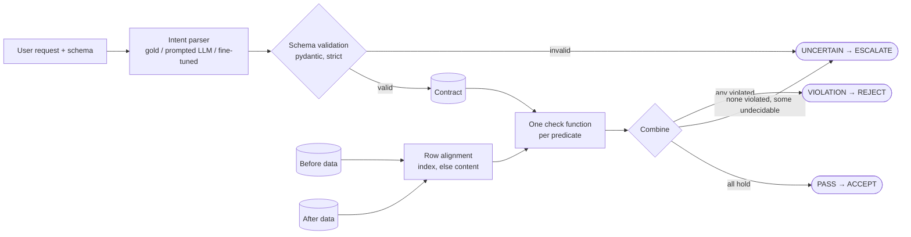
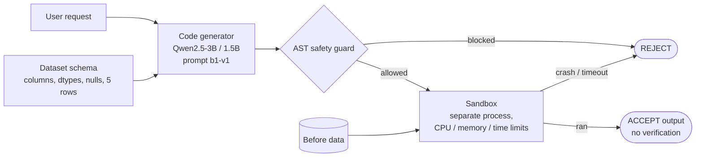
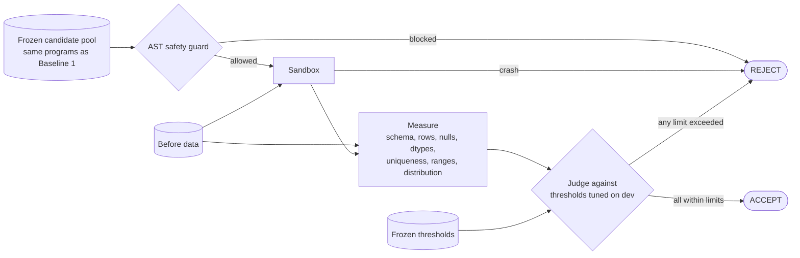
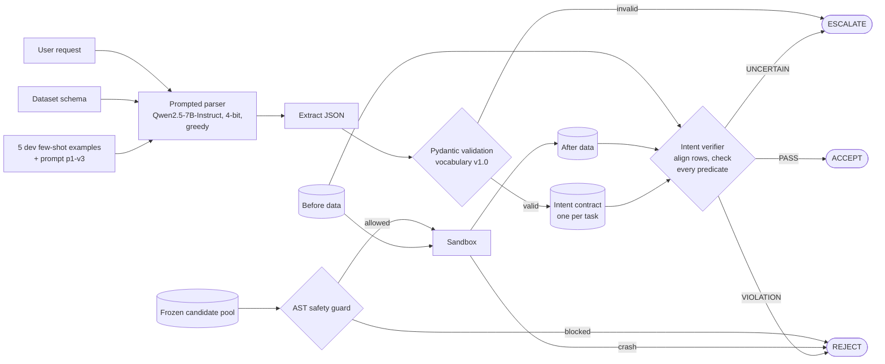
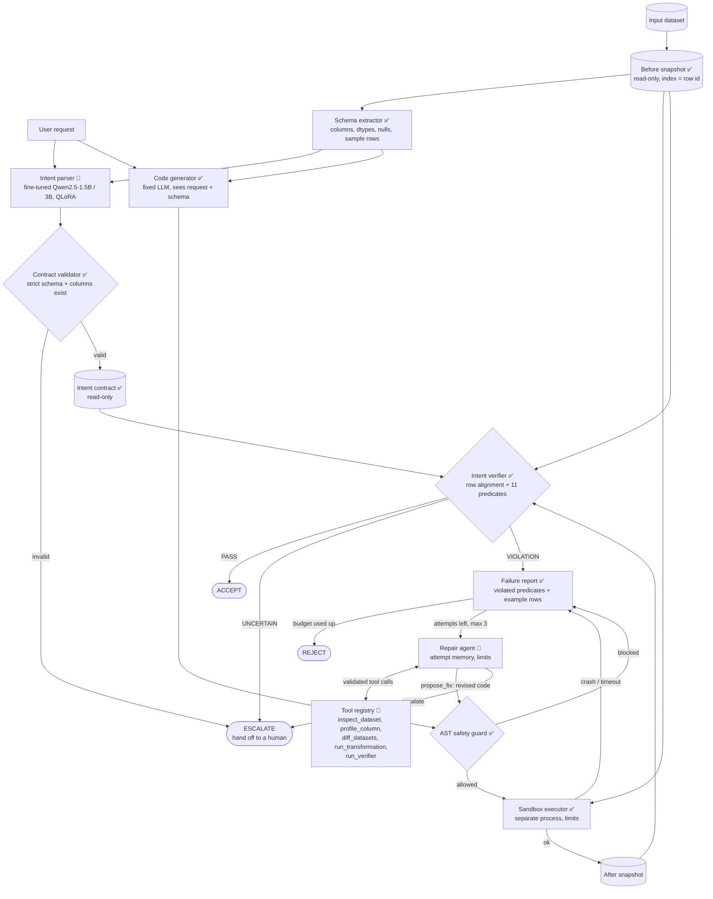

# Intent-Gated Data Transformation Agent: Mid-Submission Report

**Team SSSS** · LMA Group Project 2026
Akash Sigullapalli (2023101104) · Konapalli Jaswanth Reddy (2023101025) · Kotha Sai Veekshith (2023101078) · Srinivas Billuri (2023101029)

**Scope of this report:** all work up to and including Baseline 3 (Stage 1, verification only).
**Status labels used throughout:**

| Label | Meaning |
|---|---|
| ✅ **Completed** | Built, run, and results recorded in the repository |
| 🔄 **Ongoing** | Code exists and is tested, but the experiment has not produced final results yet |
| 📋 **Planned** | Not started, or only designed on paper |

All numbers below come from files in the repository (mainly `results/STAGE1_RESULTS.md`, `results/stage1/summary/*.json`, `benchmark/pool/manifest.json`). The direction-ablation numbers on pool v4 (§6.1) were computed for this report with `eval/metrics.py` from verdict files that already existed; no new model runs were made.

---

## Contents

0. [Project in one page](#0-project-in-one-page)
1. [Evaluation dataset creation](#1-evaluation-dataset-creation)
2. [Contract schema definition](#2-contract-schema-definition)
3. [Baseline 1: direct LLM, no verification](#3-baseline-1-direct-llm-no-verification)
4. [Baseline 2: conventional data-quality checks](#4-baseline-2-conventional-data-quality-checks)
5. [Baseline 3: intent verification with a prompted general LLM](#5-baseline-3-intent-verification-with-a-prompted-general-llm)
6. [Ablation studies and other experiments](#6-ablation-studies-and-other-experiments)
7. [Challenges faced](#7-challenges-faced)
8. [Future work](#8-future-work)
9. [Summary of status](#9-summary-of-status)

---

## 0. Project in one page

**Problem.** LLMs write pandas code that often *runs* but does the *wrong thing*: it drops valid rows, deduplicates on the wrong key, or changes columns nobody asked about. No error is raised, so the mistake is silent.

**Idea.** Turn each user request into an **intent contract**: a short list of machine-checkable statements in two halves.

- `must_change`: what the request asks to change ("every row with Age < 18 is gone").
- `must_preserve`: what must stay the same ("rows with Age ≥ 18 or unknown age are kept", "no other column changes").

After the code runs, a **deterministic verifier** (no LLM) compares the data before and after against the contract and returns PASS, VIOLATION, or UNCERTAIN.

**Research question (proposal p.1–2).** Does an intent contract that states what must change *and* what must be preserved catch more silent semantic errors in LLM-generated transformations than conventional data-quality checks?

**Hypothesis.** Intent-based verification accepts fewer incorrect transformations while keeping the false-rejection rate low.

**Two evaluation stages (proposal p.7–8).**

- **Stage 1, verification only** (this report): every system judges the *same frozen pool* of LLM-generated programs and says accept or reject. No repair.
- **Stage 2, repair** (future work): verification failures trigger a bounded, tool-using repair agent.

**Headline Stage 1 result (test split, 671 candidates, pool v4).**

| System | Recall (wrong caught) | False-rejection rate | Silent error rate |
|---|---|---|---|
| Baseline 1: no verification | 0.000 | 0.000 | 0.338 |
| Baseline 2: conventional checks | 0.455 | 0.139 | 0.244 |
| Baseline 3: prompted Qwen2.5-7B parser + intent verifier | 0.892 | 0.254 | 0.069 |
| Oracle: gold contract + intent verifier (upper bound) | 0.944 | 0.000 | 0.028 |

With a correct contract, the intent verifier catches about twice as many wrong programs as conventional checks and rejects no correct ones. With a contract written by a prompted 7B model, recall stays high but about a quarter of correct programs are rejected, mostly because the parser writes invalid or wrong contracts. Closing this gap is the job of the fine-tuned parser (future work).

---

## 1. Evaluation Dataset Creation

✅ **Completed** (task set, gold contracts, candidate pool v4). 🔄 Second annotation and agreement study not done yet (see §7).

The evaluation set has three layers:

1. **Datasets**: four real public tables (the "before" data).
2. **Tasks**: 120 hand-written requests, each with reference code and a gold contract.
3. **Candidate pool**: 803 distinct LLM-written programs for those tasks, each labelled correct or wrong.

### 1.1 Data sources

| Key | Source | File | Rows × columns | Missing cells | What makes it useful |
|---|---|---|---|---|---|
| `adult` | UCI Adult (census income) | `data/adult_dev.csv` | 1,000 × 15 | 142 (empty cells in `workclass`, `occupation`, `native-country`) | Many categorical columns; natural dedup keys |
| `airbnb` | NYC Airbnb Open Data | `data/airbnb_dev.csv` | 1,000 × 16 | 83 (`name`, `host_name`, `last_review`, `reviews_per_month`) | Prices, dates as text, host/listing keys |
| `titanic` | Titanic passenger list (Kaggle) | `data/Titanic-Dataset.csv` | 891 × 12 | 866 (`Age`, `Cabin`, `Embarked`) | Real missing values, tickets shared by groups |
| `taxi` | NYC TLC Yellow Taxi trips, January 2026 | `data/yellow_tripdata_2026-01.csv` | 1,000 × 20 | 0 (missing data is coded as sentinels such as `passenger_count = 0`, `RatecodeID = 99`) | Datetimes, money columns, sentinel values |

**Changes from the proposal.** The proposal named Airbnb, Adult and Wine Quality. During profiling we found that Wine Quality has no missing values (so no missing-value tasks are possible), so we replaced it with Titanic and NYC Taxi. Wine Quality is now reserved for fine-tuning data and must never enter evaluation. The DS-1000 external evaluation from the proposal is still planned (P2, optional).

**Profiling findings that shaped the tasks** (`docs/eval_set_and_contract_guide.md` §4.2):

- In the Adult file, missing values are empty cells, not the string `?` of the original UCI release.
- Neither Adult nor Airbnb has exact duplicate rows, so every dedup task needs a key subset.
- Airbnb prices range from 20 to 3000 (no zeros), so "remove price 0" would remove nothing and was not used.
- Library versions are pinned everywhere (pandas 2.3.3, numpy 2.1.3), because dtypes such as `object` vs `string` change between pandas versions.

The DataFrame index (0..n−1 on load) is the row id. Nothing is added to the data, so generated code sees exactly what a user would see.

### 1.2 Tasks

**120 tasks** = 4 datasets × 5 transformation types × 6 tasks.

| | Count |
|---|---|
| Transformation types | filtering, deduplication, missing values, type conversion, column transformation (24 tasks each) |
| Split | 100 **test**, 20 **dev** (one dev task per dataset × type; dev is used only for tuning prompts and thresholds) |
| Difficulty | 33 easy, 58 medium, 29 hard |
| Gold contract size | 3 to 8 predicates, 4.2 on average |

The full list is in `benchmark/tasks/INDEX.md`. Examples: "Remove passengers younger than 18; unknown ages stay" (Titanic, filtering), "Keep one listing per host and room type, keeping the last one" (Airbnb, dedup), "passenger_count 0 means not recorded; set it to missing" (Taxi, missing values), "Make education an ordered category following the education-num order" (Adult, type conversion), "Add fare_per_mile; zero-distance trips get missing" (Taxi, column transformation).

**Task file format.** Each task is one YAML file, `benchmark/tasks/<dataset>/<task_id>.yaml`:

```yaml
id: titanic_filt_003
split: test
dataset: titanic
data_file: data/Titanic-Dataset.csv
transformation_type: filtering
difficulty: medium
request: >
  Remove passengers younger than 18. Passengers whose age is unknown should stay.
assumptions:
  - "'Younger than 18' is strict: passengers aged exactly 18 are kept."
reference_code: |
  def transform(df):
      return df[~(df["Age"] < 18)].copy()
gold_contract:
  contract_version: "1.0"
  must_change:
    - {id: c1, type: rows_removed_where, target: null, condition: {column: Age, op: "<", value: 18}}
    - {id: c2, type: row_count, target: null, op: decreased}
  must_preserve:
    - id: p1
      type: rows_retained_where
      target: null
      condition: {any: [{column: Age, op: ">=", value: 18}, {column: Age, op: is_null}]}
    - {id: p2, type: columns_unchanged, target: "*", except: []}
expected_effect: {rows_before: 891, rows_after: 778, columns_added: [], columns_removed: [], cells_changed: 0}
```

| Field | Who sees it | Purpose |
|---|---|---|
| `request` | Code generator and parser | The user's question |
| `reference_code` | Evaluator only | Produces the correct output, used to label candidates |
| `gold_contract` | Evaluator, and the verifier only in the oracle setting | Answer key for parser scoring; contract for the oracle run |
| `expected_effect` | Tests | Fingerprint of the correct output, to catch accidental edits |

**Quality checks (automatic, in `tests/verifier/test_reference_contracts.py`).** Every reference output passes its own gold contract, also after `reset_index()` and after reversing the row order. Returning the input unchanged (a no-op) fails every gold contract, so no contract is vacuous.

### 1.3 Candidate pool (the transformations that are judged)

We do not hand-write wrong code. Every program in the pool was written by an LLM, which gives realistic mistakes.

**Generation (Kaggle, Tesla T4, prompt `b1-v1`, hash `ebbe8bceae71`).**

| Setting | Value |
|---|---|
| Generators | Qwen2.5-3B-Instruct and Qwen2.5-1.5B-Instruct |
| Input to the model | Request + dataset schema (column names, dtypes, missing counts, first 5 rows). No contract, no hints. |
| Samples per task per model | 1 greedy + 5 sampled (temperature 0.7, top-p 0.95, max 512 new tokens, seed rule fixed) |
| Total generations | 120 tasks × 6 × 2 models = **1,440** |
| Sandbox limits | 60 s wall clock, 30 s CPU, 4 GB memory |

**Labelling.** Each program runs in the sandbox on the before data. Its output is compared with the reference output by content (`eval/equivalence.py`: row order and index ignored, same columns, values equal with float tolerance, same dtype family). Equal → **correct**, otherwise **wrong**. Identical programs for the same task are merged, giving **803 unique candidates**.

**Pool v4 (current), `benchmark/pool/pool_v4.jsonl`:**

| Split | Candidates | Ran OK | Correct | Runnable wrong | Crashed / blocked / bad return |
|---|---|---|---|---|---|
| Test | 671 | 630 | 417 | **213** | 41 |
| Dev | 132 | 126 | 67 | 59 | 6 |

Runnable wrong candidates on test, by type: deduplication 95, filtering 45, type conversion 29, column transformation 24, missing values 20. By generator: 1.5B 134, 3B 79.

Each JSONL row stores the candidate id, task id, split, type, generator model(s), seeds, the code, its hash, run status, error message, the path of the pickled output, and the `is_correct` label. `manifest.json` records model and library versions and SHA-256 checksums of every output.

Crashed programs are kept in the pool but are not counted in the recall denominator, because every system (even Baseline 1) rejects code that crashes. The interesting errors are the 213 programs that run and are silently wrong.

**Pool history.** Pools are never edited after freezing; new candidates create a new version.

| Pool | Content | Why it was built |
|---|---|---|
| v1 | 3B, adult + airbnb, 161 candidates, 49 runnable wrong | First pool; failed Gate 1 (too few errors) |
| v2 | v1 + 1.5B, 395 candidates, 136 runnable wrong (98 test) | Gate 1 passed |
| v3 | v2 + taxi + titanic, 804 candidates, 214 test runnable wrong | Four datasets |
| **v4** | One all-task run per model, 803 candidates, 213 test runnable wrong | One clean Baseline 1 run per model. 1,438 of 1,440 generations are identical to v3. |

### 1.4 Other evaluation material (built, used later)

| Material | Location | Status |
|---|---|---|
| Error-kind labels for the 49 wrong candidates of pool v1 (most common: sorting before `keep="first"`, wrong boolean logic, incomplete dedup key) | `benchmark/annotation/error_kinds_pool_v1.csv`, `docs/error_taxonomy.md` | 🔄 Draft, needs human review |
| Red-team set: 27 unsafe code samples (file I/O, network, shell, `eval`, memory bomb, infinite loop) | `benchmark/redteam/samples.yaml` | ✅ All 22 static samples blocked, all 5 resource samples contained |
| Agent scenarios for Stage 2: R (repairable), C (already correct), T (tool fault) from the pool; E (should escalate, 15) and S (safety, 12) | `benchmark/agent_scenarios/` | 🔄 Built; E/S are drafts needing review |

---

## 2. Contract Schema Definition

✅ **Completed.** Vocabulary **v1.0 frozen on 2026-10-29.** Code: `src/igt/contracts/schema.py` (validation), `src/igt/verifier/` (checking). Full reference: `docs/contract_schema.md`.

### 2.1 What it is and why we need it

An intent contract is a JSON object that writes down, in a fixed vocabulary, what a transformation must do and what it must not touch. It is the bridge between a natural-language request and an automatic check.

We need it because:

1. **Generic checks cannot know the intent.** A check like "no more than 20% of rows removed" cannot tell whether removing rows was the point of the request. The contract carries the request's meaning into the checker.
2. **Both directions matter.** Code that removes the right rows *and some extra ones* satisfies "these rows are gone" but breaks "the other rows are kept". Code that keeps the data untouched breaks "these rows are gone". We need both halves to catch both kinds of error (tested in §6.1).
3. **Checks must be deterministic.** Each predicate has one Python function that checks it. There is no LLM judge, so the verdict is repeatable and explainable.
4. **Parser outputs must be scorable.** A closed vocabulary lets us compare a predicted contract with the gold one exactly and compute precision, recall and F1 without an LLM judge.
5. **The repair agent needs a precise failure report** (Stage 2): "predicate c1 failed, 182 rows still share a host_id, e.g. rows 12, 87, 301."

### 2.2 Structure

```json
{
  "contract_version": "1.0",
  "must_change":   [ <predicate>, ... ],
  "must_preserve": [ <predicate>, ... ]
}
```

- A transformation **satisfies** a contract when every predicate in both lists holds.
- Both lists are checked the same way. The split matters for metrics (scored separately) and for the change-only / preserve-only ablations.
- The schema is **strict**: unknown fields, unknown predicate types, and malformed values are rejected.

### 2.3 The 11 predicates

The first 8 are from the proposal (core). We added 3 extensions after the pilot (decision D5).

| # | Predicate | Holds when | Typical use |
|---|---|---|---|
| 1 | `row_count` | Row count after compares to before (`unchanged`, `decreased`, `increased`) or to a number (`eq`, `lt`, …) | Every task |
| 2 | `rows_removed_where` | Every before-row matching a condition is gone | Filtering, drop-missing |
| 3 | `rows_retained_where` *(ext.)* | Every before-row matching a condition survives | Catches over-deletion |
| 4 | `duplicate_count` | Duplicate count on key columns meets the op; optional `keep: first/last` checks *which* row survives | Deduplication |
| 5 | `null_count` | Null count in a column meets the op | Fills, sentinel → missing |
| 6 | `column_values_unchanged` | Values equal on surviving rows (dtype may change), optional `where` | Type conversion, partial fills |
| 7 | `columns_unchanged` | Column exists, same dtype family, same values on surviving rows | "Nothing else changed" |
| 8 | `column_dtype` | Column has a dtype family; optional `ordered`, `categories` | Type conversion |
| 9 | `column_value_relation` | `after[target] = fn(before row)` for a closed set of 14 functions | Fills, derived columns, mappings |
| 10 | `columns_added` *(ext.)* | Listed columns appear | New columns, renames |
| 11 | `columns_removed` *(ext.)* | Listed columns are gone | Renames, drops |

**Building blocks.**

- **Conditions** select rows, evaluated on the before data: a leaf `{column, op, value}` with `==, !=, <, <=, >, >=, in, not_in, is_null, not_null`, combined with `all`, `any`, `not`. **Null rule:** a null cell makes every comparison false (including `!=`), so a contract must say explicitly whether missing values are included.
- **Relation functions** (14): `identity, const, null, add, sub, mul, div, round, clip, lower, upper, strip, map, cast`. Arguments are written `{col: name}` or `{lit: value}`, so columns and constants are never confused.
- **Dtype families** (6): `int, float, bool, string, category, datetime`. pandas dtypes are mapped to families (for example `int64` and `Int32` are both `int`).

Usage in the 120 gold contracts: `row_count` 120, `columns_unchanged` 120, `column_value_relation` 57, `column_values_unchanged` 37, `null_count` 35, `column_dtype` 32, `rows_removed_where` 29, `rows_retained_where` 29, `duplicate_count` 24, `columns_added` 12, `columns_removed` 4.

### 2.4 Key constraints (checked when the contract is loaded)

- `contract_version` must be `"1.0"`; no unknown fields anywhere.
- A condition is exactly one of leaf / `all` / `any` / `not`; `all`/`any` cannot be empty; `in`/`not_in` need a list; `is_null`/`not_null` take no value.
- Relative count ops (`unchanged`, `decreased`, `increased`) take no `value`; absolute ops require an integer `value`.
- `keep` is allowed only with `op: eq, value: 0`.
- `ordered` and `categories` are allowed only with `dtype: category`.
- Each function has a fixed number of arguments and fixed argument kinds (e.g. `round` = [column, literal]).

A contract that breaks any rule is **invalid**. The verifier returns UNCERTAIN (`invalid_contract`) and the system **escalates** instead of guessing. This matters for Baseline 3 (§5.4).

### 2.5 How the system uses the contract



1. **Load and validate** the contract.
2. **Align rows.** Rows are matched by index label. If the index was lost (for example after `reset_index(drop=True)`), rows are matched by the content of columns the contract says are unchanged. If the match is still ambiguous, row-level predicates return UNCERTAIN (`rows_unmatched`).
3. **Check every predicate** (no early stop). A referenced column that does not exist gives UNCERTAIN (`unknown_column`).
4. **Combine:** any violation → VIOLATION; otherwise any uncertain → UNCERTAIN; otherwise PASS. In Stage 1, PASS = ACCEPT, VIOLATION = REJECT, UNCERTAIN = ESCALATE (counted as "not accepted").
5. **Report** each failure with the predicate id, expected vs observed value, and up to 5 example row ids (`docs/verdict_format.md`).

**Scoring a predicted contract against the gold one** (`src/igt/contracts/normalize.py`, `eval/contract_metrics.py`): `"*"` targets are expanded to one key per column (partial credit), conditions are put in a canonical form (sorted children, flattened `all`/`any`, double negation removed, numbers normalised), and keys are compared. We report precision, recall and F1 separately for `must_change` and `must_preserve`, plus exact-match rate. An invalid prediction counts as empty.

**Test coverage.** The contracts and verifier are covered by unit tests for every predicate (pass, violation, edge cases such as empty frames, all-null columns, index reset, unmatchable rows). The whole test suite (435 tests, also covering sandbox, parsers and agent) passes.

### 2.6 Known limitations of v1.0 (kept on purpose)

| Limitation | Effect | Decision |
|---|---|---|
| No predicate forbids **extra columns** (`columns_unchanged "*"` covers only before-columns) | A leftover helper column passes | Kept as a reported limitation (OI-7). Changing the vocabulary after seeing test results would tune the method on the test set. |
| New columns have no dtype unless the contract adds `column_dtype` | A new int column computed as float passes | Same |
| No nested expressions, column-to-column conditions, datetime arithmetic, regex, group statistics | Requests like "fill with the median" need the median written as a literal | Documented in task notes |

---

## 3. Baseline 1: Direct LLM, No Verification

✅ **Completed.**

### 3.1 What it is

The LLM writes the code; the code runs; whatever comes out is accepted. The only rejection is code that crashes or is blocked by the safety checker.

### 3.2 Why we chose it

It measures the problem itself: how often an LLM produces code that runs but is wrong. Every other system is compared to this "do nothing" reference. It also produces the candidate pool that all other systems judge.

### 3.3 Implementation

- Prompt `b1-v1` (`src/igt/agents/code_generator.py`). The system prompt asks for a single `transform(df)` function using only pandas and numpy, with no file or network access. The user message contains the row and column counts, each column's name, dtype and missing count, the first 5 rows as CSV, and the request. The schema text comes from a frozen file (`benchmark/prompts/schema_b1-v1.json`) so prompts are byte-identical across runs.
- Run on Kaggle (T4) with Qwen2.5-3B-Instruct and Qwen2.5-1.5B-Instruct (`notebooks/kaggle/gate1_generate_kaggle.ipynb`; executed copies in `notebooks/executed/`).
- The code block is extracted from the reply, checked by the AST safety guard (only pandas/numpy imports; blocks `open`, `eval`, `exec`, `os`, `sys`, `subprocess`, `socket`, dunder access), then run in a separate process with CPU, memory, file-size and time limits (`src/igt/sandbox/`).

**Architecture (Baseline 1):**



### 3.4 Results

**Generator accuracy on the 100 test tasks** (correct = output equal to the reference):

| Model | Decoding | adult | airbnb | taxi | titanic | All |
|---|---|---|---|---|---|---|
| Qwen2.5-3B | greedy (1 per task) | 20/25 | 21/25 | 18/25 | 18/25 | **77/100** |
| Qwen2.5-3B | all 6 samples | 0.800 | 0.827 | 0.747 | 0.720 | 464/600 (0.773) |
| Qwen2.5-1.5B | greedy | 20/25 | 17/25 | 20/25 | 19/25 | **76/100** |
| Qwen2.5-1.5B | all 6 samples | 0.733 | 0.693 | 0.720 | 0.693 | 426/600 (0.710) |

**As a verifier (test, 671 unique candidates):** recall 0.000, false-rejection rate 0.000, **silent error rate 0.338** (213 of the 630 accepted outputs are wrong).

Silent error rate by type: deduplication **0.556**, filtering 0.324, type conversion 0.319, column transformation 0.220, missing values 0.167.

**Interpretation.**

- Even with greedy decoding, about **1 task in 4 is solved wrongly**, and the code runs without error.
- About **one third of the distinct programs that run are silently wrong**. For deduplication it is more than half: the models often sort before `drop_duplicates(keep="first")`, or deduplicate on part of the key.
- The pool has enough real errors for a meaningful comparison (Gate 1: target ≈ 60+, we have 213 on test).
- **Reproducibility check:** rerunning the full generation gave 1,438 of 1,440 identical generations. The 2 differences come from batched fp16 greedy decoding (padding differs with batch composition).

---

## 4. Baseline 2: Conventional Data-Quality Checks

✅ **Completed.**

### 4.1 What it is

The same candidate outputs are judged by a fixed suite of **generic data-quality checks** that compare before and after data. The checks never see the request, a contract, or the reference.

### 4.2 Why we introduced it

The research question asks whether intent contracts beat *conventional* checks, so we need a fair, tuned conventional baseline. If intent verification only matched schema/null/range checks, there would be no reason for a contract. The proposal lists the check families (p.6): schema, nulls, dtypes, uniqueness, ranges, row/column consistency, distribution changes.

### 4.3 Implementation

`src/igt/baselines/conventional_checks.py`, driver `eval/baseline2.py`, config `configs/baseline2_v4.yaml`. We wrote the checks ourselves in plain pandas (rather than Great Expectations or Pandera) so every rule is visible.

**Step 1: measure** (once per candidate):

| Family | Measurement |
|---|---|
| Schema | duplicate column names; number of dropped columns |
| Rows | output/input row ratio; output index not a subset of the input index; empty output |
| Nulls | largest increase in null fraction in any column; null fraction in new columns |
| Dtypes | columns whose dtype family changed (strict, or only "incompatible" changes) |
| Uniqueness | columns that were unique and stopped being unique; increase in fully duplicated rows |
| Ranges | fraction of numeric values outside the input min/max |
| Distribution | mean shift in standard deviations (z); total variation distance of categorical columns; fraction of new category values |

**Step 2: judge.** Each measurement is compared with a threshold. Any exceeded threshold → VIOLATION (reject).

**Tuning (dev split only).** A greedy coordinate search over a grid of 13 thresholds maximises dev recall subject to dev false-rejection rate ≤ 0.10. Ties go to the more lenient value ("lenient" tie-break). The thresholds are then frozen and applied to test. We also report a "strict" tie-break and hand-set "default" thresholds as sensitivity checks (§6.4).

The tuned (lenient) setting keeps only three checks active:

| Active check | Threshold |
|---|---|
| Dropped columns | more than 1 → reject |
| Output index not a subset of input index | any → reject |
| Mean shift of a numeric column | z > 0.1 → reject |

Dev score: recall 0.627, FRR 0.090.

**Architecture (Baseline 2):**



The checks never receive the request, a contract, or the reference output.

### 4.4 Results (test, pool v4)

| Metric | Baseline 1 | **Baseline 2** |
|---|---|---|
| Recall (runnable wrong rejected) | 0.000 | **0.455** [0.33, 0.58] |
| False-rejection rate | 0.000 | **0.139** [0.07, 0.22] |
| Silent error rate | 0.338 | **0.244** |
| Accepted outputs | 630 | 475 |

Brackets: 95% task-level bootstrap intervals. McNemar (paired, "was the decision right"): Baseline 2 right on 97 candidates where Baseline 1 was wrong, the reverse on 58 (p = 0.002).

**By transformation type (recall / FRR):**

| Type | Runnable wrong | Recall | FRR |
|---|---|---|---|
| Deduplication | 95 | 0.60 | **0.49** |
| Filtering | 45 | 0.62 | 0.22 |
| Column transformation | 24 | 0.38 | 0.00 |
| Missing values | 20 | 0.15 | 0.00 |
| Type conversion | 29 | **0.00** | 0.00 |

**What triggers the decisions.** On test, all 58 false rejections come from the mean-shift check, which also catches 88 of the 97 caught errors. The other checks contribute little (dropped columns 6, index not subset 5, empty output 3).

**Interpretation.**

- Conventional checks catch less than half of the silent errors and reject about 1 in 7 correct outputs.
- They are blind to **type-conversion errors** (0 of 29 caught): a wrong category order or a wrong dtype does not move means or row counts.
- In deduplication and filtering they cannot tell a *requested* change from an *unrequested* one: a correct dedup also shifts means, so the same check that catches errors rejects half the correct dedups.
- The tuned baseline mostly reduces to one statistic (mean shift). This is the expected weakness of request-blind checks, and it is the gap the research question is about.

---

## 5. Baseline 3: Intent Verification with a Prompted General LLM

✅ **Completed** (final version: Qwen2.5-7B-Instruct, prompt p1-v3).

### 5.1 What it is

The full intent-gated pipeline, with the contract written by a **general-purpose LLM that is only prompted, not fine-tuned**. The verifier, the candidate pool and the metrics are the same as for the oracle run. Only the source of the contract changes.

### 5.2 Why we introduced it

- It is the proposal's comparison point for fine-tuning (p.7): if a prompted model already writes good contracts, fine-tuning adds nothing.
- It tests the research question under realistic conditions. The oracle run (gold contracts) shows the *ceiling* of intent verification; Baseline 3 shows what happens when the contract itself can be wrong.
- We deliberately use a **larger** model (7B) than the parsers we will fine-tune (1.5B, 3B), which makes the test harder for fine-tuning.

### 5.3 Implementation

`src/igt/agents/intent_parser.py`, `eval/parse_contracts.py` (GPU, Kaggle notebook `notebooks/kaggle/baseline3_parse_kaggle.ipynb`), `eval/score_parsers.py` (scoring, CPU).

**Model and decoding.** Qwen2.5-7B-Instruct, 4-bit, fp16 compute, **greedy** decoding, max 1,024 new tokens, Kaggle T4. Decision (README §12): every LLM parser uses the same plain greedy generation, then JSON extraction from the reply and strict pydantic validation. No constrained decoding, no output repair, no lenient parsing. Invalid outputs are counted and escalated.

**Prompt.** System prompt + 5 few-shot examples + the task.

- The **system prompt** lists the 11 predicates, conditions, functions and dtypes in compact form, and the default preservation rule ("rows not targeted are kept, columns not mentioned are unchanged, no rows are added").
- The **few-shot examples** are 5 dev tasks, one per transformation type (`adult_dedup_006`, `airbnb_filt_006`, `airbnb_miss_006`, `adult_conv_006`, `adult_col_006`). Test tasks can never be few-shot examples (enforced by an assertion); when parsing a dev task, its own example is left out.
- The **user message** has the same schema block as the code generator (first 3 rows) and the request.

**Three prompt versions** (each one kept and reported):

| Version | Change | Reason |
|---|---|---|
| p1-v1 | Base prompt | First run |
| p1-v2 | + 7 explicit format rules (six dtype words only, `all`/`any` not `and`/`or`, one object per argument, no `median`/`mean`, `ordered` only with category, `keep` only with eq 0) | Each rule targets an invalid-output type that also appeared on **dev** in p1-v1 |
| p1-v3 | + a "reference card" with one exact JSON snippet for every vocabulary element the few-shot examples do not show | Inspection showed the examples demonstrate only 1 of 14 functions and 4 of 10 condition operators |

**Selection rule (fixed before p1-v3 was run):** for each model, the final version is the one with the lowest **dev** invalid rate (ties: dev F1, then the earlier version). Test results are never used to choose. For 7B, p1-v3 was selected (dev invalid 0.25, dev mean F1 0.807).

**Architecture (Baseline 3):**



The parser runs once per task, and its contract is reused for every candidate of that task. The oracle run uses the same diagram with the gold contract in place of the parser.

### 5.4 Results

**(a) Contract quality (100 test tasks, Qwen2.5-7B):**

| Prompt | Invalid contracts | Exact match | must_change P / R / F1 | must_preserve P / R / F1 |
|---|---|---|---|---|
| p1-v1 | 0.34 | 0.17 | 0.925 / 0.589 / 0.720 | 0.988 / 0.632 / 0.771 |
| p1-v2 | 0.33 | 0.14 | 0.924 / 0.576 / 0.709 | 0.981 / 0.638 / 0.773 |
| **p1-v3 (Baseline 3)** | **0.13** | **0.27** | 0.874 / 0.658 / **0.751** | 0.984 / 0.840 / **0.906** |

The model's predicates are mostly correct (high precision) but it leaves some out (lower recall), and 13% of its contracts break the schema.

**(b) Verification (test, 671 candidates, pool v4):**

| System | Recall | FRR | Silent error rate | ESCALATE rate |
|---|---|---|---|---|
| Baseline 1: no verification | 0.000 | 0.000 | 0.338 | 0.000 |
| Baseline 2: conventional checks | 0.455 [0.33, 0.58] | 0.139 [0.07, 0.22] | 0.244 | 0.000 |
| **Baseline 3: prompted 7B, p1-v3** | **0.892** [0.82, 0.95] | **0.254** [0.16, 0.36] | **0.069** | 0.148 |
| Oracle: gold contract (upper bound) | 0.944 [0.90, 0.98] | 0.000 [0.00, 0.00] | 0.028 | 0.006 |

Paired McNemar on test:

| Comparison | First system right only | Second system right only | p |
|---|---|---|---|
| Baseline 3 vs Baseline 2 | 140 | 95 | **0.004** |
| Oracle vs Baseline 2 | 164 | 2 | < 0.001 |
| Oracle vs Baseline 3 | 117 | 0 | < 0.001 |

**(c) By type (recall / FRR):**

| Type | Baseline 2 | Baseline 3 | Oracle |
|---|---|---|---|
| Deduplication | 0.60 / 0.49 | 0.95 / 0.21 | 0.95 / 0.00 |
| Filtering | 0.62 / 0.22 | 0.91 / 0.23 | 0.98 / 0.00 |
| Type conversion | 0.00 / 0.00 | 0.72 / 0.32 | 1.00 / 0.00 |
| Column transformation | 0.38 / 0.00 | 0.96 / 0.32 | 0.96 / 0.00 |
| Missing values | 0.15 / 0.00 | 0.75 / 0.21 | 0.75 / 0.00 |

**(d) Where Baseline 3's decisions come from (test, runnable candidates):**

| | PASS | VIOLATION | UNCERTAIN (escalated) |
|---|---|---|---|
| Correct candidates (417) | 311 | 55 | 51 |
| Wrong candidates (213) | 23 | 142 | 48 |

- Of the 106 false rejections, **51 are escalations caused by invalid contracts** and 55 are violations of predicates the parser wrote wrongly (most often `column_value_relation` 17, `rows_removed_where` 12, `row_count` 10).
- Of the 190 wrong candidates not accepted, 142 are caught by a real violation (most often `duplicate_count` 66, `columns_unchanged` 40) and 48 are escalated. Without the escalations, violation-based recall would be 142/213 = 0.667. Part of the high recall comes from invalid contracts escalating everything for that task, including wrong code.

**Interpretation.**

1. **The research hypothesis holds when the contract is right.** With gold contracts the verifier catches 94% of silent errors at 0% false rejections, against 46% / 14% for conventional checks. The oracle catches type-conversion errors that conventional checks cannot see at all.
2. **With a prompted 7B parser, intent verification is significantly better than conventional checks overall** (p = 0.004), mainly through much higher recall (0.89 vs 0.46). The silent error rate falls from 0.244 to 0.069.
3. **The cost is false rejections.** One correct output in four is rejected, against one in seven for Baseline 2. Half of this comes from invalid contracts, half from wrong predicates.
4. **The oracle gap (FRR 0.254 → 0.000) is the room left for a better parser.** This is the motivation for fine-tuning (Gate 3).
5. **The oracle's 12 misses are known vocabulary or annotation gaps, not verifier bugs:** 8 programs leave an extra helper column (no predicate forbids extra columns, OI-7), and 4 taxi programs turn `passenger_count` into `object` dtype, which the gold contracts of `taxi_miss_001/005` do not constrain (annotation gap, OI-8).

**Caveats to keep in mind.**

- **Oracle FRR = 0 is close to guaranteed by construction.** "Correct" means equal to the reference, and every reference passes its gold contract. A correct-but-different interpretation is labelled *wrong* by the answer key, so it cannot appear as a false rejection.
- **Gold contracts are drafts by one annotator.** The second annotation and agreement study are not done yet, so oracle numbers are an upper bound.
- **Test results of p1-v1 had been seen before p1-v2 was written.** The changes were limited to format rules justified by dev errors, and the final version was chosen on dev. We report all versions.
- **Candidates are correlated within a task.** Confidence intervals use a task-level bootstrap for this reason.

---

## 6. Ablation Studies and Other Experiments

All ✅ **Completed**, Stage 1, test split unless stated otherwise.

### 6.1 Direction ablation: must_change only vs must_preserve only

**Question.** Is the "bidirectional" contract (the proposal's claimed novelty) needed, or does one half suffice?

**What we changed.** The contract filter keeps only `must_change` or only `must_preserve`. Verifier, pool and everything else stay the same. We ran it with gold contracts and with the Baseline 3 contracts.

| Contract | Recall | FRR | Silent error rate |
|---|---|---|---|
| Oracle, full | **0.944** | 0.000 | **0.028** |
| Oracle, must_change only | 0.732 | 0.000 | 0.120 |
| Oracle, must_preserve only | 0.446 | 0.000 | 0.221 |
| Baseline 3, full | **0.892** | 0.254 | **0.069** |
| Baseline 3, must_change only | 0.770 | 0.211 | 0.130 |
| Baseline 3, must_preserve only | 0.545 | 0.165 | 0.218 |

Recall by type with gold contracts (full / change only / preserve only): filtering 0.98 / **0.38** / 0.91; deduplication 0.95 / 0.88 / **0.22**; column transformation 0.96 / 0.92 / **0.25**; type conversion 1.00 / 0.83 / 0.62; missing values 0.75 / 0.45 / 0.45.

McNemar, oracle full vs change-only: 45 vs 0 candidates; full vs preserve-only: 106 vs 0 (both p < 0.001).

**Findings.**

- **Both halves are needed, and they catch different errors.** must_change alone misses most filtering errors: code that removes the right rows *and more* still satisfies "these rows are gone". must_preserve alone misses most dedup and column errors: it cannot see that the requested change did not happen (duplicates left, wrong row kept, wrong value computed).
- With gold contracts, the full contract is right on every candidate where a half-contract is right.
- With the parser's contracts the pattern is similar. Dropping a half lowers FRR a little (fewer predicates that can be wrong) but costs much more recall. Full vs change-only is not significant here (26 vs 18 candidates, p = 0.29); full vs preserve-only is (74 vs 37, p < 0.001).

The same result held on pool v2 (2 datasets): full 0.980, change only 0.847, preserve only 0.347.

### 6.2 Parser model-size ablation (prompted 7B vs 3B vs 1.5B)

**Question.** How much does parser size matter without fine-tuning? This lets us later separate the effect of fine-tuning from the effect of size (prompted 1.5B vs fine-tuned 1.5B).

**What we changed.** Only the parser model (Qwen2.5-7B / 3B / 1.5B-Instruct). Same prompts, decoding, verifier and pool. Each size uses its own dev-selected prompt version.

| Parser (dev-selected prompt) | Invalid | must_change F1 | must_preserve F1 | Recall | FRR | Silent error rate | ESCALATE |
|---|---|---|---|---|---|---|---|
| 7B (p1-v3) = Baseline 3 | **0.13** | **0.751** | **0.906** | 0.892 | **0.254** | 0.069 | 0.148 |
| 3B (p1-v2) | 0.29 | 0.411 | 0.781 | 0.958 | 0.578 | 0.049 | 0.297 |
| 1.5B (p1-v3) | 0.34 | 0.395 | 0.730 | 0.953 | 0.796 | 0.105 | 0.356 |

**Findings.** Bigger is clearly better on every contract metric and on FRR. Small prompted parsers have "high recall" only because they reject almost everything: the 1.5B parser rejects 80% of correct outputs, which makes it useless in practice. This is the baseline the fine-tuned 1.5B and 3B parsers must beat.

### 6.3 Prompt-version ablation (p1-v1 → p1-v2 → p1-v3)

**What we changed.** Only the system prompt (§5.3). All 9 model × prompt runs are kept (`results/stage1/other_prompts/`, `size_ablation/`, `baseline3/`).

| Parser | Prompt | Invalid (test) | Invalid (dev) | must_change F1 | must_preserve F1 | Recall | FRR |
|---|---|---|---|---|---|---|---|
| 7B | p1-v1 | 0.34 | 0.35 | 0.720 | 0.771 | 0.930 | 0.417 |
| 7B | p1-v2 | 0.33 | 0.25 | 0.709 | 0.773 | 0.911 | 0.384 |
| 7B | **p1-v3** | **0.13** | 0.25 | 0.751 | 0.906 | 0.892 | **0.254** |
| 3B | p1-v1 | 0.44 | 0.45 | 0.403 | 0.660 | 0.911 | 0.683 |
| 3B | **p1-v2** | 0.29 | 0.35 | 0.411 | 0.781 | 0.958 | 0.578 |
| 3B | p1-v3 | 0.22 | 0.40 | 0.525 | 0.831 | 0.953 | 0.506 |
| 1.5B | p1-v1 | 0.50 | 0.75 | 0.329 | 0.588 | 0.925 | 0.801 |
| 1.5B | p1-v2 | 0.44 | 0.60 | 0.367 | 0.658 | 0.850 | 0.751 |
| 1.5B | **p1-v3** | 0.34 | 0.35 | 0.395 | 0.730 | 0.953 | 0.796 |

Bold prompt = selected on dev. For 3B the dev rule picked p1-v2 although p1-v3 is better on test; we follow the rule and report both.

**Findings.**

- The format rules (p1-v2) helped the 3B model most (44% → 29% invalid). The reference card (p1-v3) **cut the 7B's invalid outputs from 33% to 13%** and raised its preserve F1 from 0.77 to 0.91, as the coverage analysis predicted.
- Even the best prompt leaves 13–34% invalid contracts. Remaining errors are the same kinds: condition operators outside the vocabulary, merged arguments, pandas dtype names, `keep` with the wrong op. Small prompted models do not follow a strict schema reliably. This is the main argument for fine-tuning.

### 6.4 Baseline 2 sensitivity (tie-break and untuned thresholds)

**What we changed.** The tuning tie-break rule, and tuned vs hand-set thresholds.

| Variant | Recall | FRR | Silent error rate |
|---|---|---|---|
| Tuned, lenient tie-break (main) | 0.455 | 0.139 | 0.244 |
| Tuned, strict tie-break | 0.502 | 0.264 | 0.257 |
| Hand-set default thresholds | 0.742 | 0.561 | 0.231 |

**Findings.** Making conventional checks stricter buys recall only with many more false rejections. None of the variants approaches the intent verifier's trade-off, and even Baseline 3 is right more often than the strict variant (171 vs 84 candidates, p < 0.001). Our choice of the lenient variant is not what makes Baseline 2 look weak.

### 6.5 Effect of adding datasets (pool v2 → v3/v4)

**What we changed.** The evaluation pool grew from 2 datasets (98 test errors) to 4 datasets (213 test errors). Thresholds and prompts stayed fixed.

| System | Pool v2 recall / FRR | Pool v4 recall / FRR |
|---|---|---|
| Baseline 2 | 0.510 / 0.081 | 0.455 / 0.139 |
| Baseline 3 (7B p1-v3) | 0.969 / 0.228 | 0.892 / 0.254 |
| Oracle | 0.980 / 0.000 | 0.944 / 0.000 |
| Baseline 3 vs Baseline 2 (McNemar) | 61 vs 45, p = 0.14 (not significant) | 140 vs 95, **p = 0.004** |

**Findings.** Conventional checks get weaker on the larger pool (on pool v4 they catch none of the 29 type-conversion errors). With twice the data, the advantage of Baseline 3 over Baseline 2 becomes statistically significant. Moving from pool v3 to v4 changed every rate by at most 0.002.

### 6.6 Generator comparison (3B vs 1.5B as code writers)

The two generators have almost the same greedy accuracy (77 vs 76 of 100 test tasks), but the 1.5B model is wrong more often when sampling (0.710 vs 0.773 sample accuracy) and contributes 134 of the 213 runnable wrong candidates. Adding the second generator is what made Gate 1 pass (pool v1 with 3B alone had only 32 test errors).

---

## 7. Challenges Faced

| # | Challenge | What happened | How we handled it | Status |
|---|---|---|---|---|
| 1 | **Too few wrong programs** (Gate 1) | Pool v1 (3B only, 2 datasets) had 49 runnable wrong candidates, 0 in two of the five types | Added a second, smaller generator (1.5B) and two more datasets (taxi, titanic). Now 213 test errors over all five types | ✅ Resolved. Column transformation (24) and missing values (20) are still the thinnest types |
| 2 | **Small LLMs write invalid contracts** | First Baseline 3 run: 34–50% of contracts broke the schema (pandas dtype names, `and`/`or`, merged arguments, `median` as a function) | Format rules from dev errors (p1-v2), reference card covering the whole vocabulary (p1-v3). Strict schema kept for every parser; no output repair | 🔄 Reduced to 13–34%. The rest is left for fine-tuning; constrained decoding or one re-ask are options if applied to all parsers |
| 3 | **Keeping the test set clean** | p1-v1 test results were seen before p1-v2 was written; Baseline 2's tie-break was chosen after both variants' test numbers were printed | Fixed selection rules on dev only, all versions reported, disclosures in `results/STAGE1_RESULTS.md` and `docs/open_issues.md` (OI-5, OI-9) | ✅ Handled by disclosure |
| 4 | **Matching rows before and after** | After `reset_index()`, filters, or sorting, it is not obvious which output row came from which input row | Index = row id; fallback to content matching on columns the contract says are unchanged; UNCERTAIN if ambiguous. Two alignment bugs were found during testing (late rows removed after a reset; in-place damage to exactly the preserved columns) and fixed | ✅ Resolved; earlier verdicts re-checked and unchanged |
| 5 | **Verifier bug found in parser analysis** | Names in `except` of `columns_unchanged "*"` were treated as column references, so excluding a newly added column gave UNCERTAIN | Fixed per spec; oracle and Baseline 2 verdicts byte-identical after the fix; all prompted runs re-scored | ✅ Resolved |
| 6 | **Vocabulary gaps** | No predicate forbids extra columns; new columns are untyped. Costs the oracle 8 of 213 detections | Kept v1.0 frozen and reported the gap; any v1.1 will be a versioned re-run for every system | 📋 Open by design (OI-7) |
| 7 | **Single-annotator gold contracts** | All 120 gold contracts were written by one person, who also wrote the reference code | Automatic checks (reference passes, no-op fails); oracle numbers reported as an upper bound | 🔄 Second annotation and agreement study pending (OI-8) |
| 8 | **Weak conventional baseline risk** | Tuned Baseline 2 relies almost entirely on one statistic (mean shift), tuned on a small dev split (20 tasks) | Documented checks, dev-only tuning, strict and default variants reported (§6.4) | ✅ Handled; small dev split is a stated limitation (OI-2) |
| 9 | **Non-determinism in greedy decoding** | Batched fp16 greedy decoding changed 2 of 1,440 generations between runs | Frozen pools; later systems reuse saved generations instead of regenerating; one clean all-task run per model (pool v4) | ✅ Resolved |
| 10 | **Sandbox isolation on our machines** | `unshare -rn` (network namespace) is not allowed on the dev laptop; the filesystem is not isolated | Fallback: socket API replaced in the child process; the AST guard blocks file, network and shell access first; 27 red-team samples all blocked or contained | 🔄 Acceptable for Stage 1 (model-generated, non-adversarial code). Docker with `--network none` would close the gap (OI-6) |
| 11 | **Limited GPU** | Only Kaggle T4 (16 GB) available | 4-bit 7B model, small batches, all GPU work in notebooks with saved outputs; scoring runs on CPU from saved files | ✅ Working |
| 12 | **First agent dev run failed** (Stage 2 preparation) | 0 of 14 repairable dev scenarios fixed; the action parser mistook dict literals in code for JSON actions and rejected code-only replies | Parser fixes and agent prompt a1-v2; all model replies now saved. The a1-v1 numbers are not used as results | 🔄 Ongoing; rerun pending |

---

## 8. Future Work

### 8.1 Fine-tuning data

🔄 **Ongoing.** Guide, checking tools, training script and Kaggle notebook are ready and smoke-tested. The training data itself has not been generated yet.

**Goal.** 3,000–5,000 examples of *request + schema → contract*, in exactly the same chat format the parser sees at evaluation time (`docs/finetune_data_guide.md`).

**Plan.**

1. **Datasets that are never used in evaluation.** Eight candidate files are already downloaded in `data/finetune/`: air-quality health data, avocado prices, UCI Bank Marketing, Diamonds, IMDB top 1000, UCI Student Performance, Walmart sales, and one more (`train.csv`). Wine Quality is also allowed. For each: a fixed 500–1,500-row sample, a profile, licence and checksum. One or two whole datasets are held out for validation.
2. **Templates.** 30–40 patterns covering all five types, all 11 predicates, all 14 functions and every condition operator. Each pattern links a request template, a contract template and a reference-code template. Values come from the data, so contracts are non-vacuous. At least four phrasing styles per pattern (plain, casual, domain words, indirect). Null handling is generated in both readings and stated in the request.
3. **Generation and balance.** 4,000–6,000 raw examples, about 20% per type, no dataset above 20%, no pattern above 5%. Optional paraphrases by a larger model (≤ 30%), with a meaning check.
4. **Automatic checks** (`finetune/data_gen/check_examples.py`), 7 per example: not an evaluation dataset; valid v1.0 contract with real column names; reference code passes the safety guard and runs; the reference output **passes** the contract under our verifier; a no-op does **not** pass; no shared 5-word phrase with any evaluation request and character similarity ≤ 0.75 (leakage check); no duplicates.
5. **Hand review** of 100 random examples (20 per type); regenerate if more than ~5% are wrong.
6. **Build SFT files** (`finetune/data_gen/build_sft.py`) with the p1-v2 system prompt (format rules, no reference card), split by whole dataset.

**Training setup (ready):** QLoRA (4-bit nf4) on Qwen2.5-1.5B-Instruct and Qwen2.5-3B-Instruct; LoRA r = 16, α = 32, dropout 0.05; learning rate 2e-4; 2 epochs; effective batch 16; max sequence 3,072 tokens; loss on contract tokens only; over-long examples dropped, not truncated. A CPU smoke run on Qwen2.5-0.5B dropped the loss from 0.55 to 0.05 in 6 steps and the reloaded adapter produced a valid contract. Adapters record their training prompt version and refuse to parse with another one.

### 8.2 Additional baselines and systems

| System | Stage | What it adds | Status |
|---|---|---|---|
| **Proposed: fine-tuned Qwen2.5-1.5B and 3B parsers** + intent verifier | 1 | Main comparison against Baseline 3 (Gate 3: match or beat prompted 7B on contract F1) | 🔄 Pipeline ready, waiting for data |
| Baseline 2 + repair, Baseline 3 + repair, Proposed + repair, Oracle + repair | 2 | Final transformation accuracy, repair success, attempts; Baseline 1 stays the no-repair reference | 📋 Planned |
| Agent baselines: no repair; **naive retry** (only told "verification failed"); **feedback retry** (full failure report, no tools); **full agent** (failure report + tools + memory + escalation) | 2 | Separates the value of the failure report, of tool use, and of the agent's decisions (TA feedback on agent evaluation) | 🔄 Code built and tested with a scripted LLM; real-model runs pending |
| LLM-as-verifier (an LLM judges before/after directly) | 1 | A non-contract LLM baseline; would need validation against human labels | 📋 Optional (P2) |
| DS-1000 pandas subset (20–30 problems) | 1 | External validity, reported separately | 📋 Optional (P2) |

### 8.3 Additional ablations

| Ablation | Question | Status |
|---|---|---|
| Fine-tuned vs prompted at the **same size** (1.5B, 3B) | Is the gain from fine-tuning or from size? (the size ablation in §6.2 is the prompted half) | 📋 After fine-tuning |
| Change-only / preserve-only with fine-tuned contracts | Does the bidirectional result hold for the proposed parser? | 📋 |
| Predicted vs oracle contract gap for every parser | How much error comes from misunderstanding intent? | ✅ for prompted parsers; 📋 for fine-tuned |
| 3 seeds for LLM components; confidence intervals and McNemar for every comparison | Stability of results | 🔄 Intervals and McNemar done; extra seeds planned |
| Decoding variant for **all** parsers at once: constrained JSON decoding, or one re-ask with the validation error | Can format errors be removed without fine-tuning? | 📋 Option (OI-9) |
| Vocabulary v1.1 (forbid extra columns, type new columns) as a versioned re-run | Cost of the known vocabulary gap | 📋 Only after main results |
| Agent ablations: no memory; coarse failure report (pass/fail only); contract hidden from the agent; no escalate action; repair without tools | Which agent parts matter? | 🔄 Implemented as modes; not run |
| Fine-tuning data ablations (size of training set; with/without paraphrases) | Data needs of the parser | 📋 If time allows |

Other planned work: second annotation of ~20% of gold contracts and agent scenarios with an agreement study; human review of error-kind labels and E/S scenarios; red-team set through every Stage 2 system; qualitative case studies and failure taxonomy.

### 8.4 Final architecture (proposed)

The final system adds the fine-tuned parser and the repair agent to the Stage 1 pipeline. Components marked ✅ exist today; 🔄 exist and are tested but have not produced results; 📋 are planned.



**Workflow.**

1. **Prepare:** load the data (index = row id), freeze the before snapshot, extract the schema.
2. **Parse:** the fine-tuned parser writes the contract; invalid → ESCALATE; valid → frozen (read-only).
3. **Generate:** the code generator writes `transform(df)` from the request and schema only.
4. **Safety check and execute** in the sandbox. Blocked code, crashes and timeouts become failure reports.
5. **Verify** against the contract: PASS → ACCEPT; UNCERTAIN → ESCALATE; VIOLATION → failure report.
6. **Repair:** the agent reads the failure report and its history, may call allow-listed tools, then proposes new code (back to step 4) or escalates. Limits: 3 repair attempts, 8 tool calls per attempt, a fixed token budget, and repeated-code detection.
7. **Finish:** the outcome and a full JSONL trace are written. The evaluator scores them offline against the reference; ground truth never reaches the runtime.

**Rules that protect the results:** the contract and the before snapshot are read-only, so the agent cannot "fix" a violation by weakening the checks; every code execution, including agent tool calls, goes through the safety guard; the verifier is deterministic and uses no LLM; generator, decoding and budgets are the same for every system.

---

## 9. Summary of Status

| Area | Status | Key output |
|---|---|---|
| Evaluation set: 4 datasets, 120 tasks, gold contracts, reference code | ✅ (agreement study 🔄) | `benchmark/tasks/` |
| Candidate pool v4: 803 LLM programs, labelled | ✅ | `benchmark/pool/` |
| Contract schema v1.0 + deterministic verifier | ✅ | `src/igt/contracts/`, `src/igt/verifier/`, `docs/contract_schema.md` |
| Sandbox + AST guard + red-team set | ✅ (Docker isolation 📋) | `src/igt/sandbox/`, `benchmark/redteam/` |
| Baseline 1 (direct LLM) | ✅ | silent error rate 0.338 |
| Baseline 2 (conventional checks) | ✅ | recall 0.455, FRR 0.139 |
| Oracle-contract run | ✅ | recall 0.944, FRR 0.000 |
| Baseline 3 (prompted 7B, p1-v3) | ✅ | recall 0.892, FRR 0.254; significantly better than Baseline 2 (p = 0.004) |
| Ablations: direction, parser size, prompt version, Baseline 2 sensitivity, dataset growth | ✅ | §6 |
| Fine-tuning data and QLoRA parsers | 🔄 tooling ready, data not generated | `finetune/`, `docs/finetune_data_guide.md` |
| Repair agent, tools, orchestrator, agent scenarios | 🔄 built and tested with a scripted LLM; first real dev run invalid, rerun pending | `src/igt/agents/`, `src/igt/tools/`, `src/igt/orchestrator/` |
| Stage 2 end-to-end, agent evaluation, DS-1000, write-up | 📋 | — |

**Main conclusion so far.** A bidirectional intent contract lets a deterministic verifier catch silent errors that request-blind data-quality checks miss, especially in deduplication and type conversion. With gold contracts the gain is large and comes with no false rejections. With a prompted 7B parser the gain is still significant, but invalid and incomplete contracts cause many false rejections. The quality of the parser is now the bottleneck, which is what the fine-tuning phase targets.
