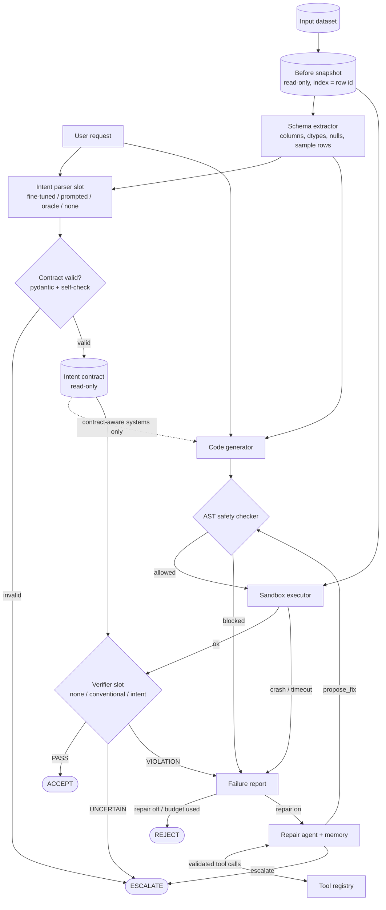

# System design: Intent-Gated Data Transformation Agent

This document explains **what we built, how it is structured, and why each part is designed the way it
is**. It also covers the plan we followed and where the final system differs from that plan.

Sources: `docs/history/implementation_roadmap.md` (the plan), `report_acl/final_report.tex`, the code in
`src/igt/`, `eval/`, `finetune/`, and the design docs under `docs/`.

---

## 1. The problem and the idea in one page

**Problem.** An LLM writes a pandas function `transform(df)` from a natural-language request. The code
often *runs* but does the *wrong thing*: it removes extra rows, deduplicates on the wrong key, fills every
column instead of one, uses the wrong category order, or leaves a helper column. About a third of runnable
LLM programs in our pool are silently wrong. Generic data-quality checks can't reliably catch this,
because they don't know what the user asked for.

**Idea.** Make the user's intent explicit and checkable:

1. An **intent parser** turns the request into an **intent contract**: a short list of checkable
   predicates in two halves, `must_change` (what the request asks for) and `must_preserve` (what a
   reasonable user expects to stay the same).
2. The generated code runs in a **sandbox** behind an **AST safety checker**.
3. A **deterministic verifier** (no LLM) checks every predicate against the data before and after.
4. If the check fails, a bounded, **tool-using repair agent** reads the failure report and tries to fix
   the code, or escalates to a human.

Every run ends in exactly one of three outcomes: **ACCEPT, REJECT or ESCALATE**.

---

## 2. Design principles (the "why" behind everything)

These eight principles explain most individual design decisions.

| # | Principle | What it led to | Why |
|---|---|---|---|
| P1 | **The judge must be deterministic** | Verifier is plain Python, one function per predicate; no LLM judge anywhere | An LLM judge would add noise and would need its own validation. A deterministic verifier gives the same verdict every time and is fully explainable. |
| P2 | **Ground truth never enters the runtime** | Separate offline evaluation harness; the agent never sees reference code, reference outputs or gold contracts | Otherwise results could be inflated by leakage. The only exception is the gold contract in the oracle configuration, which is the point of that ablation. |
| P3 | **The agent can only change code, never the check** | Contract and the "before" data are read-only | An agent that can weaken the contract could "fix" a violation by deleting the predicate. That would inflate repair success. |
| P4 | **Every system is a configuration of the same parts** | Slots: parser (none / prompted / fine-tuned / oracle), verifier (none / conventional / intent), generator sees contract (yes/no), repair (on/off) | Fair comparisons: same generator, decoding, sandbox, budgets. Only the slot under test differs. |
| P5 | **No code runs without the safety checker** | `run_transformation` tool and every `propose_fix` go through the same AST guard and sandbox | Tools are a second way to run code; without this they would bypass safety. |
| P6 | **Test the core idea first, with oracle contracts** | Phase order: verifier + gold contracts + frozen pool before any parser | If even correct contracts can't beat conventional checks, the project fails early (week 4, not week 8). |
| P7 | **Only real LLM errors** | Candidate pool = LLM-generated code, labelled by comparing outputs with the reference | Hand-written bugs would be unrealistic and could be designed to favour our method. |
| P8 | **Build the research core ourselves** | Verifier, conventional checks, agent loop, tool registry and orchestrator are plain Python, not Great Expectations / LangChain | The course grades understanding of these mechanisms; frameworks would hide exactly the logic being evaluated. |

---

## 3. Architecture

### 3.1 Runtime pipeline (Stage 2, full system)



### 3.2 Stage 1 mode (verification only)

Stage 1 removes the live generator and the repair loop. Every system judges the **same frozen pool** of
LLM-written programs, so comparisons are paired (McNemar test). The parser runs once per task and its
contract is reused for every candidate of that task.

```
frozen pool → safety check → sandbox → verifier slot → ACCEPT / REJECT / ESCALATE
                                          ↑
                         parser slot → contract
```

**Why two stages?** Stage 1 isolates *detection* (RQ1): is the checker good, independent of generation
and repair? Stage 2 measures *end-to-end accuracy* (RQ2): does the whole system deliver more correct
outputs? Mixing them would make it impossible to tell whether a gain came from better checking or
better repair.

### 3.3 Runtime vs evaluation harness

```
┌──────── Runtime (never sees ground truth) ────────┐      ┌──── Evaluation harness (offline) ────┐
│ parser → generator → guard → sandbox → verifier   │ ───▶ │ outputs_equal(reference, output),    │
│        → repair agent → outcome + JSONL trace     │      │ contract P/R/F1, agent metrics,       │
└───────────────────────────────────────────────────┘      │ safety metrics, McNemar, bootstrap   │
        ▲ gold contract only in oracle config              └──────────────────────────────────────┘
```

The runtime writes outputs and traces; the evaluator reads them **afterwards**. "Final accuracy" is
always judged against the reference output, not by our own verifier, so an agent that "games" the
verifier still scores as wrong.

### 3.4 Orchestrator state machine

`src/igt/orchestrator/state_machine.py` defines the **only** legal transitions; an illegal one raises
`IllegalTransition`, so a bug can't silently skip the safety check or the verifier.

```
PREPARE → PARSE | GENERATE
PARSE → ESCALATED (invalid contract) | GENERATE
GENERATE → SAFETY_CHECK
SAFETY_CHECK → EXECUTE | FAILED (blocked)
EXECUTE → VERIFY | FAILED (crash / timeout)
VERIFY → ACCEPTED | ESCALATED (uncertain) | FAILED (violation)
FAILED → REPAIR | REJECTED
REPAIR → REPAIR (tool call) | SAFETY_CHECK (propose_fix) | ESCALATED | REJECTED (budget)
```

**Limits** (`orchestrator/limits.py`): 3 repair attempts, 8 tool calls per attempt, 60,000 tokens per
task, 3 invalid actions (Stage 2); identical code proposed twice → ESCALATE (detected by hash in
`orchestrator/memory.py`). These stop loops and make every system's budget identical.

---

## 4. Modules: what we built

### 4.1 Library: `src/igt/`

| Package / file | Responsibility | Key design choice and why |
|---|---|---|
| `types.py` | Shared data types: `Verdict`, failure records (`predicate_failure`, `check_failure`, `execution_failure`, `uncertain_failure`), verdict record validation | Agreed **first** (Phase 0) so team members could work in parallel against one interface. Every verifier returns the same `Verdict(status, failures, evidence_rows)`. |
| `paths.py`, `config.py` | Every path defined once; run configuration | Repo was restructured once; one place for paths avoids broken references. |
| **`contracts/`** | | |
| `schema.py` | Pydantic models for the 11 predicates, conditions, 14 relation functions, 6 dtype families | **Strict validation**: unknown fields or predicate types are rejected; an invalid contract is never hand-repaired, the system escalates. |
| `normalize.py` | Canonical form of predicates; narrow normalisation of harmless formatting (e.g. `"> "` → `">"`) | Canonical keys make contract F1 / exact match well defined; normalisation never changes meaning. |
| `precheck.py` | Contract self-check on the input table only: unknown columns, filter values that match no row, dedup keys with no duplicates | Catches parser misreadings without any ground truth; triggers one correction request. |
| **`verifier/`** | | |
| `alignment.py` | Match rows before/after by index label; fall back to content matching if the index was lost; otherwise UNCERTAIN | Generated code often does `reset_index`; content fallback avoids false violations, and UNCERTAIN avoids guessing. |
| `conditions.py` | Evaluate `{column, op, value}` leaves combined with `all / any / not`, on the **original** data | Null cells make every comparison false, so contracts must state null handling explicitly. |
| `functions.py` | The 14 relation functions (`identity, const, null, add, sub, mul, div, round, clip, lower, upper, strip, map, cast`) | Closed set → deterministic, exact checking of derived columns. |
| `values.py` | Value equality: null == null, int/float compared numerically, float tolerance 1e-9 | Avoids false violations from dtype or float noise. |
| `predicates.py` | One check function per predicate type | Each predicate is unit-tested in isolation. |
| `intent_verifier.py` | Combine: any violation → VIOLATION; else any uncertain → UNCERTAIN; else PASS. Report predicate id, expected vs observed, up to 5 example rows | The report is exactly what the repair agent sees, so it must be precise. |
| **`baselines/`** | | |
| `conventional_checks.py` | Baseline 2: generic data-quality suite (schema, rows, nulls, dtypes, uniqueness, ranges, distribution) split into `measure()` and `judge()` | Split so thresholds can be tuned cheaply on dev without re-running code. |
| `llm_verifier.py` | LLM-as-verifier baseline | Implemented, **not run** (future work). |
| **`sandbox/`** | | |
| `ast_guard.py` | Static allow-list: only `pandas`/`numpy` imports; blocks `open, exec, eval, compile, __import__, os, sys, subprocess, socket, pathlib, shutil`, pandas/numpy file I/O, dunder access | Cheapest and strongest layer; blocks before anything runs. Every block is logged as an unsafe attempt. |
| `executor.py` | Runs code in a separate `python -I` process in an empty temp dir, with CPU / memory / wall-clock / file / output limits; socket API replaced by a stub; data in/out by file; safe unpickler for results | Isolates crashes, infinite loops and memory bombs. `unshare -rn` wasn't permitted on our machines, hence the socket stub. |
| `environment.py`, `docker_executor.py` | Minimal environment; optional Docker executor | Docker was the planned stronger option; kept optional. |
| **`tools/`** | | |
| `registry.py` | `Tool(name, description, args_schema, handler)`, argument validation, allow-list, structured errors, output clipping | Invalid arguments and unknown tools return an observation instead of crashing, which lets us measure recovery. |
| `data_tools.py` | `inspect_dataset`, `profile_column`, `diff_datasets`, `run_transformation` (guard + sandbox, on a copy), `run_verifier` | All read-only; the agent can investigate but can't change data or the contract. |
| `faults.py` | Fault injection: force an error / timeout / malformed result on the n-th call of a tool | Needed for T scenarios (tool-fault recovery), a graded tool-calling metric. |
| **`llm/`** | | |
| `client.py` | `LLMClient` interface with **`ScriptedBackend`** (replays pre-written responses), response cache keyed by (model, messages, tokens, temperature, top_p, seed), token budget (`BudgetExceeded`) | Scripted backend lets every agent control path be tested deterministically without a GPU (Gate 4). Cache makes reruns cheap and reproducible. |
| `hf.py`, `vllm_backend.py` | transformers backend; optional vLLM | One interface, swappable backends. |
| **`agents/`** | | |
| `code_generator.py`, `code_generator_v2.py` | Prompts `b1-v1` (request + schema) and `b2-v2` (+ contract + implementation rules) | Schema text comes from a frozen file so prompts are byte-identical across runs. |
| `code_extract.py` | Extract `transform` code from model output | |
| `intent_parser.py` | Prompted parser: vocabulary + default-preservation rule + 5 dev few-shot examples; greedy; JSON extraction; strict pydantic | An assertion ensures test tasks are never used as few-shot examples. |
| `tool_parser.py`, `tool_parser_ft.py` | Parser that can call read-only data tools before writing the contract (prompted and fine-tuned) | Lets the parser look up statistics it can't see. |
| `reask.py` | Re-ask the parser once after an invalid contract | Implemented; used by later parsers. |
| `repair_agent.py` (+ `_ext`, `_v5`) | The repair loop: each step is one action — tool call, `propose_fix(code)` or `escalate(reason)`; action parsing; three modes (full / feedback / naive) | Plain Python loop so every decision is visible in the trace. |
| **`orchestrator/`** | `state_machine.py`, `memory.py` (attempt history, repeated-code hash), `limits.py` | Enforces invariants and budgets outside the model. |
| **`pipeline/`** | `failure_report.py` (one format for violations, check failures, crashes, safety blocks), `trace_view.py` | One report format shared by Baseline 2 and intent systems, so repair is compared fairly. |

### 4.2 Evaluation code: `eval/`

| Area | Files | Purpose |
|---|---|---|
| Ground-truth labelling | `equivalence.py`, `label_candidates.py` | `outputs_equal`: compare by content, ignore row order and index, same columns and dtype families, ordered categories same order, floats rounded to 9 decimals. |
| Candidate pool | `generate.py`, `build_pool.py` | Generate 1 greedy + 5 sampled programs per task per model, dedupe identical code, freeze pool with a manifest of output hashes. |
| Stage 1 systems | `baseline1_by_dataset.py`, `baseline2.py`, `run_intent_oracle.py`, `parse_contracts*.py`, `score_parsers.py`, `run_llm_verifier.py` | Run each system over the frozen pool. |
| Metrics | `metrics.py`, `contract_metrics.py`, `agent_metrics.py`, `stage2_metrics.py`, `error_kind_breakdown.py` | Recall, FRR, silent error rate, escalation; contract P/R/F1 and exact match; agent metrics; bootstrap CIs; McNemar. |
| Agent evaluation | `build_agent_scenarios.py`, `runner_agent.py`, `show_trace.py`, `trajectory_labels.py` | R / C / T scenarios from the pool, E / S by hand; full / feedback / naive agents. |
| Stage 2 | `runner_stage2.py` (presets per system) and one package per experiment: `stage2_clean`, `stage2_independent(_v2)`, `stage2_selective`, `stage2_tools`, `stage2_dual_3b`, `stage2_combined_3b`, `stage2_combined_gold`, `stage2_contract_check`, `stage2_repair_dev`, `stage2_repair_hints`, `stage2_baselines_hints` | **Each later experiment imports the earlier frozen code and swaps only the part under test**, then restores it. This guarantees that only one thing changes between runs. |
| Safety | `safety_table.py`, `with_sandbox.py` | Red-team samples through every execution path. |
| Demo | `demo.py`, `app/demo_app.py` | Shows a silent error being caught next to the conventional checks. |

### 4.3 Fine-tuning: `finetune/`

| Part | Purpose |
|---|---|
| `datasets/`, `data_gen/prepare_datasets.py` | 7 training datasets + 1 validation dataset, **none used in evaluation**; ~1,000-row snapshots with injected missing values, sentinels, duplicates, whitespace. |
| `data_gen/generate_examples.py`, `check_examples.py` | 43 patterns × 4 request styles; keep an example only if the contract is valid, the reference passes and a no-op fails, and there's no 5-gram overlap with evaluation requests. |
| `train_qlora.py`, `train_qlora_tools.py` | QLoRA training (4-bit NF4, LoRA r16 / α32, lr 2e-4, 2 epochs); loss on contract tokens (or all assistant turns for tool use). |
| `selective_facts*`, `tool_use/` | Later parser variants that receive data facts. |

### 4.4 Benchmark and records

| Folder | Content | Design choice |
|---|---|---|
| `benchmark/tasks/` | 120 task YAMLs: request, assumptions, reference code, gold contract, expected effect | One file per task; `_006` of each dataset/type is dev. |
| `benchmark/pool/` | Frozen pool v4 + manifest + output pickles | **Frozen** so every system judges identical inputs. |
| `benchmark/agent_scenarios/` | R / C / T (`rct_v4.jsonl`), E/ and S/ YAMLs | Tests agent behaviour separately from end-to-end accuracy. |
| `benchmark/redteam/` | 27 unsafe programs | Safety must be measured, not asserted. |
| `benchmark/annotation/` | Error-kind labels, sheets for second annotation and trajectory labels | |
| `tools/` | Analysis and audit scripts that produce `results/` | Results are regenerated from raw outputs, not typed by hand. |
| `notebooks/kaggle/` | Notebooks with **sealed source packs** (zip + manifest hash) | The exact code that ran on Kaggle is recorded; a CPU collector verifies records against frozen hashes. |
| `reproduce_all.sh` | Recomputes Stage 1 and safety results on CPU | Headline numbers are reproducible from the repo. |
| `tests/` | Unit and regression tests for verifier, sandbox, tools, parsers, every Stage 2 experiment | e.g. every reference passes its gold contract, also after `reset_index` and row reversal; no no-op passes. |

---

## 5. Design of the core pieces in detail

### 5.1 The intent contract

**Structure.** A JSON object with two lists, `must_change` and `must_preserve`. A transformation
satisfies the contract when every predicate in both lists holds.

**Vocabulary (closed, 11 predicates).** `row_count`, `rows_removed_where`, `rows_retained_where`,
`duplicate_count` (with `keep: first/last`), `null_count`, `column_values_unchanged`,
`columns_unchanged`, `column_dtype`, `column_value_relation`, `columns_added`, `columns_removed`.

**Why two halves?**
Users state what should change but rarely what should stay the same. Without `must_preserve`, code that
removes the right rows *and some extra ones* still satisfies "these rows are gone". Without
`must_change`, nothing says the requested change happened. Ablation A1 confirmed it: with gold
contracts, full 0.944 recall vs change-only 0.732 vs preserve-only 0.446.

**Why a closed vocabulary instead of free-form code or natural language?**
- It can be checked **deterministically** (P1).
- It can be scored **exactly** against a gold contract (F1, exact match).
- A small model can learn it by fine-tuning.
- It can't contain unsafe code.
The cost: some things can't be expressed (no "no extra columns" predicate, no dtype for a new column).
We kept the vocabulary frozen after annotation instead of changing it after seeing test results.

**Authoring rules** (`docs/eval_set_and_contract_guide.md`): requests don't state what must be
preserved; default preservation (untargeted rows kept, unmentioned columns unchanged, nothing added);
complete but minimal (every plausible wrong reading must fail some predicate); non-vacuous (every
`must_change` predicate affects at least one row); explicit null handling.

### 5.2 The verifier

Four steps: **align rows → check each predicate → combine → report**.
Three verdicts, not two: **UNCERTAIN** exists so the verifier never guesses when rows can't be matched
or a referenced column is missing. UNCERTAIN becomes ESCALATE, which hands the decision to a human
instead of silently accepting or rejecting.

### 5.3 The parser: how the design evolved

| Version | Design | Result | Why we moved on |
|---|---|---|---|
| Prompted 7B (Baseline 3) | Few-shot prompt, 3 prompt versions selected on dev | 13% invalid, FRR 0.254 | Small prompted models can't follow a strict schema (13–34% invalid). |
| **Fine-tuned 1.5B / 3B** (QLoRA) | Zero-shot, trained on 3,614 synthetic examples from non-eval datasets | 2% invalid, FRR 0.165 / 0.158 | Remaining errors were semantic: it **guessed statistics it couldn't see** (median 37 vs 28). |
| **Selective facts 1.5B** | A rule-based router computes only the statistics the request needs and adds them to the input | FRR 0.120, recall 0.944 | Deterministic, cheap; limited to supported request forms. |
| **Tool-use 1.5B** | Parser calls read-only tools (`profile_column`) before writing | 1% invalid, best change F1 0.873, FRR 0.139 | More general; more tokens. |
| + normalisation + self-check | Fix harmless formatting; check contract against the input table; one correction | Fewer invalid / impossible contracts | |

**Why greedy decoding + strict validation instead of constrained decoding?** The plan used constrained
decoding. We chose plain greedy generation with strict pydantic validation for **every** parser, so all
parsers are compared under the same conditions and invalid-output rate is a real, measurable metric.

**Why fine-tune a small model instead of using a bigger one?** Ablation A3: a fine-tuned 1.5B beats a
prompted 7B on every contract metric. Smaller is cheaper and faster per request.

### 5.4 The repair agent: how the design evolved

| Version | Design | Why |
|---|---|---|
| Naive retry | Regenerate after "verification failed" | Agent baseline: value of feedback |
| Feedback retry | Regenerate with the failure report, no tools | Agent baseline: value of tools |
| **Full agent** (Qwen2.5-7B 4-bit, prompt a1-v4) | Failure report + tools + memory of earlier attempts + `escalate` action | The proposed agent; 58/82 repaired vs 51 / 50 |
| **Final: 3B FP16 + combined loop + schema guard + repair hints** | Short attempt history, fresh recovery request, schema guard (no undeclared columns), **recipes** (pandas code per failed predicate) and **lints** (static checks for repeated pandas mistakes) | The 3B agent was cheaper but repeated the same mistakes even with correct contracts (84/100 with gold). Hints raised it to 92 with gold, 82 / 80 with our parsers. |

**Why bounded?** Fixed budgets (3 attempts, 8 tools/attempt, 60k tokens) make systems comparable and
prevent loops. **Why read-only contract?** So repair success can't be inflated by weakening the check.
**Why an escalate action?** The system should hand off impossible or contradictory requests (E scenarios).

### 5.5 Safety design

Two layers, defence in depth:
1. **AST guard** (static, before running) — main protection.
2. **Sandbox** (runtime) — contains what static analysis can't see: infinite loops, memory bombs,
   recursion, output floods.

Applied on **every** execution path: generator code, the `run_transformation` tool, and repair
proposals. Result: 27/27 red-team programs blocked or contained, 0 unsafe executions in all runs.
Known gap: filesystem not isolated and network only stubbed, so the AST guard carries most of the weight.

### 5.6 Conventional checks (Baseline 2) design

Built in plain pandas (not Great Expectations) so every rule is visible in one file and its behaviour is
documented exactly. `measure()` once per candidate, `judge()` per threshold set, so 13 thresholds can be
grid-searched on dev (max recall at ≤10% FRR). Three variants reported (tuned lenient, tuned strict,
untuned) so nobody can argue the baseline was weakened.

---

## 6. Evaluation design

| Layer | What | Why this design |
|---|---|---|
| **Datasets** | Adult, Airbnb, Titanic, NYC Taxi (~1,000 rows each) | Different pitfalls: categoricals, text dates, real missing values, sentinels. pandas/numpy versions pinned because dtypes differ across versions. |
| **Tasks** | 4 datasets × 5 types × 6 = 120; 100 test / 20 dev | Balanced coverage; dev only for tuning prompts and thresholds. |
| **Candidate pool** | 1,440 generations (Qwen2.5-3B + 1.5B, 1 greedy + 5 sampled each) → 803 unique; test: 630 runnable, 213 wrong | Two generators and sampling give enough **real** errors (Gate 1). |
| **Labels** | Content equality with the reference output | Objective; no human or LLM judgement needed. |
| **Agent scenarios** | R 82, C 95, T 24, E 12, S 9 (test) | Tests repair, leaving correct code alone, tool-fault recovery, escalation, safety. |
| **Statistics** | Task-level bootstrap CIs; exact McNemar on paired decisions | Candidates within a task are correlated, so we resample tasks; all systems judge the same items, so paired tests are valid. |

---

## 7. The plan we followed

### 7.1 Phases and gates (from `docs/history/implementation_roadmap.md`)

| Phase | What | Gate / milestone |
|---|---|---|
| 0 | Repo, shared `types.py`, data, GPU check | Everyone can run tests |
| 1 | Contract schema + deterministic verifier | All predicate tests pass; vocabulary frozen |
| 2 | Task set, gold contracts, E/S scenarios | Task set frozen |
| 3 | Sandbox, AST guard, tools, fault hooks, red-team set | Red-team 100% blocked |
| 4 | LLM backend (incl. scripted), generator, candidate pool, R/C/T scenarios | **Gate 1:** enough real errors? ✔ (213 runnable wrong on test) |
| 5 | Stage 1 harness with oracle contracts + Baselines 1, 2 | **MVP-1, Gate 2:** oracle beats conventional? ✔ |
| 6 | Prompted parser = Baseline 3, direction ablations | **MVP-2** |
| 7 | Fine-tuning data + QLoRA parser | **Gate 3:** fine-tuned ≥ prompted 7B? ✔ |
| 8 | Full Stage 1 evaluation | Main Stage 1 table |
| 9 | Repair agent, state machine, scripted-path tests | **Gate 4:** all control paths pass with scripted LLM, **MVP-3** |
| 10 | Agent evaluation (added after TA feedback) | Agent results table |
| 11 | Stage 2 end-to-end + safety | Stage 2 table |
| 12 | Analysis, write-up, demo | Submission |

**Critical path:** 0 → 1 → 4 → 5 → 6 → 7 → 8 → 11 → 12, with 9 → 10 in parallel to 7–8.
**Planned ownership (3 people):** A = contracts, verifier, parser, fine-tuning; B = tasks, pool,
baselines, metrics, evaluation; C = sandbox, tools, LLM serving, repair agent, agent evaluation.

**Why gates?** Each gate is a go/no-go check on a risk that could sink the project (not enough errors,
idea doesn't work with perfect contracts, fine-tuning doesn't help, agent logic broken) before spending
GPU time on the next phase.

### 7.2 After the plan: improvement iterations

After the first Stage 2 result (76 vs 78 for direct generation), the failure analysis showed wrong
contracts were the bottleneck. The follow-up experiments, each changing one thing on frozen code:

`independent` / `selective` / `tools` runs → `dual_3b` (3B FP16 repair) → `combined_3b` (improved loop)
→ `combined_gold` → `contract_check` (self-check + correction) → `repair_dev` → **`repair_hints`**
(final) → `baselines_hints` (baselines re-run on the final stack).

### 7.3 Plan vs what we actually did

| Planned | Actual | Reason |
|---|---|---|
| ~70 tasks on Airbnb, Adult, Wine | 120 tasks on Adult, Airbnb, Titanic, Taxi | More tasks for statistical power; datasets with real missing values and sentinels |
| Generator Qwen2.5-Coder-7B | Qwen2.5-3B and 1.5B | Smaller models give a realistic error rate (Gate 1) |
| Constrained decoding for parsers | Greedy + strict pydantic validation for all parsers | Same conditions for every parser; invalid rate becomes a measured result |
| Network cut with `unshare -n` or Docker | Socket stub in the child process | Network namespaces weren't permitted on our machines |
| 3 seeds per LLM component | 1 run, greedy, seed 0 | Compute; variance checked once (1/720 generations differed) |
| Second annotator, agreement study | Sheets prepared, not done | Time |
| Agent ablations (no memory, coarse report, hidden contract, no escalate) | Implemented, not run | Time / GPU |
| Human trajectory labels | Sheets prepared, not labelled | Time |
| Repair agent 7B | Final config 3B FP16 with hints | 3B with hints ≈ 7B quality (92 vs 94 with gold) at lower cost |
| — | Selective-facts and tool-use parsers, contract self-check, schema guard, repair hints | Added after failure analysis; developed on the same test tasks (so diagnostic) |
| — | 240 extra tasks on 8 UCI datasets | Built for a future held-out confirmation; not yet used |

---

## 8. Key design decisions and the alternatives we rejected

| Decision | Alternatives considered | Why we chose this |
|---|---|---|
| Deterministic verifier | LLM-as-judge | Reproducible, explainable, no judge validation needed; LLM verifier kept only as an unrun baseline |
| Closed 11-predicate vocabulary | Free-form Python assertions; natural-language specs | Checkable, scoreable, safe, learnable by a small model |
| Two-sided contract | Only "what changes" | Users don't state preservation; A1 shows both halves are needed |
| Frozen LLM-generated pool | Hand-injected bugs | Realistic errors; paired comparisons |
| Fine-tuned small parser | Prompted large model | A3: 1.5B fine-tuned beats 7B prompted; cheaper |
| Escalate on invalid / uncertain | Repair the contract by hand, or guess | Honest: a human sees cases the system can't decide |
| Read-only contract during repair | Let the agent revise the contract | Prevents gaming the verifier |
| Plain-Python agent and tools | LangChain / LangGraph | Every decision visible; graded mechanisms not hidden |
| Plain-pandas conventional checks | Great Expectations / Pandera | Logic visible in one file; cheap threshold tuning |
| Systems as slot configurations | Separate code per system | Fairness: everything else identical |
| Each new Stage 2 experiment imports frozen earlier code | Edit code in place | Only the component under test changes; old results stay reproducible |
| Scripted LLM backend | Test only with real models | Deterministic tests of every agent path, no GPU needed |

---

## 9. Known design limitations

1. **A wrong contract is checked as if it were right.** Nothing checks the contract against the request
   (e.g. `neighbourhood` vs `neighbourhood_group` accepted a 0-row output).
2. **Vocabulary gaps:** no "no extra columns" predicate (closed only by the final schema guard), no dtype
   for new columns.
3. **Coverage trade-off:** 16–22% of tasks withheld vs 2% for direct generation; needs human review.
4. **Cost:** ~5–6× the tokens of direct generation, parser inference not counted.
5. **Sandbox:** filesystem not isolated; network only stubbed.
6. **Agent:** rarely escalates on its own; completes the safe part of unsafe requests instead of refusing.
7. **Evaluation:** single seed; no inter-annotator agreement; final configuration developed on the same
   test tasks.

---

## 10. Short answers for the viva

- **"Describe your architecture in one breath."** Parser writes a two-sided contract; generator writes
  pandas code; AST guard and sandbox run it safely; a deterministic verifier checks the contract on
  before/after data; a bounded tool-using agent repairs failures or escalates; an offline harness scores
  everything against reference outputs.
- **"Why is the verifier not an LLM?"** Determinism, explainability, no judge validation, and the agent
  can't argue with it.
- **"Why two stages?"** Stage 1 isolates detection on a frozen pool with paired tests; Stage 2 measures
  end-to-end accuracy with live generation and repair.
- **"How do you keep comparisons fair?"** Systems are configurations of shared slots: same generator,
  decoding, sandbox, budgets; only the slot under test changes.
- **"What would you redesign?"** Add a check that the contract matches the request (e.g. two
  independent contracts or user confirmation), a "no extra columns" predicate, and stronger sandbox
  isolation.
